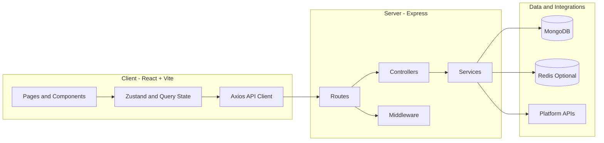
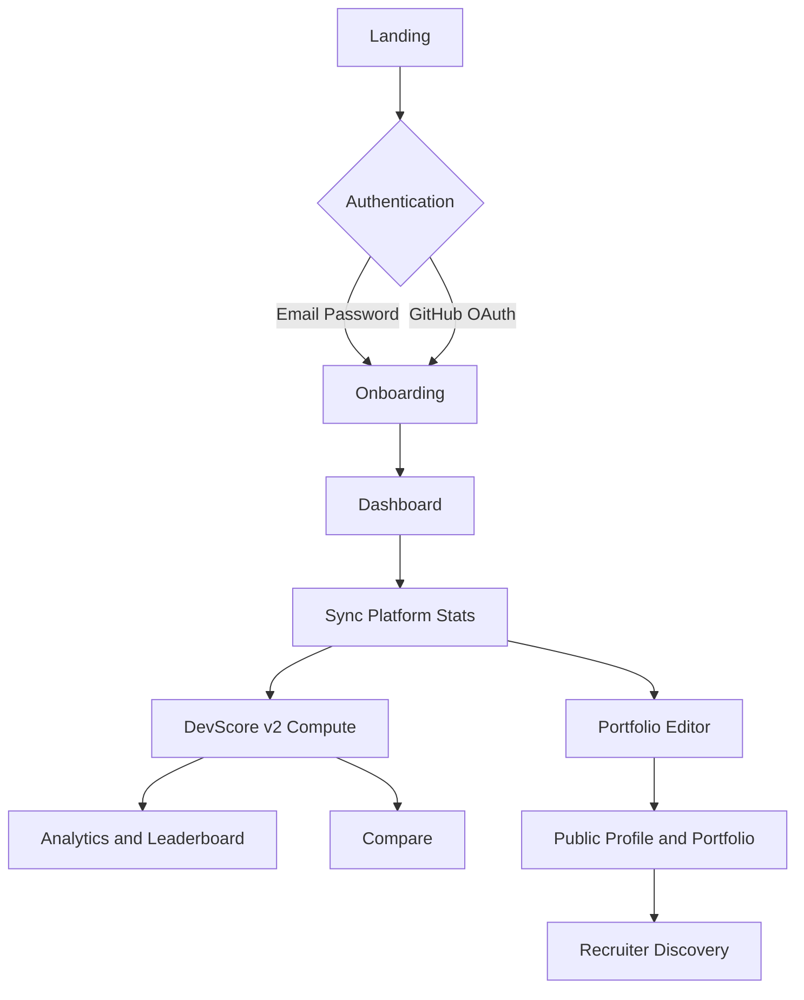

<div align="center">

# DevFolio

Unified developer identity platform for building, scoring, comparing, and showcasing real work across coding and AI platforms.

[](client/)
[](server/)
[](documentation/DATABASE_SCHEMA.md)
[](server/src/config/redisClient.js)

[Project Overview](#project-overview) • [Core Capabilities](#core-capabilities) • [Architecture](#architecture-snapshot) • [Quick Start](#quick-start) • [Documentation](#documentation-map)

</div>

Last updated: 2026-03-29

---

## Project Overview

DevFolio converts fragmented developer activity into a single, credible profile with measurable signals.

It combines platform stats, scoring, portfolio publishing, and recruiter discovery in one product:

- Developer onboarding and profile management
- Multi-platform sync for coding and open-source signals
- DevScore v2 with diagnostics and benchmark context
- Public profile + portfolio publishing
- Leaderboard, compare, recruiter search, and admin operations

Current platform coverage (core 7):

- GitHub
- LeetCode
- Codeforces
- HackerRank
- CodeChef
- Kaggle
- Hugging Face

---

## Core Capabilities

### Developer Experience

- Authentication (email/password + GitHub OAuth)
- Guided onboarding and handle linking
- Unified dashboard with score, streaks, and recent activity
- Analytics deep dive with platform-specific visualizations
- Portfolio editor, save flow, visibility toggle, and public preview
- Peer comparison and leaderboard positioning

### Recruiter and Admin Experience

- Recruiter search with score and profile filters
- Candidate profile evaluation with platform signals
- Admin user management and global sync controls
- Contest feed for upcoming events

### Scoring Model

- DevScore v2 in range 0-1000
- 5 pillars: problem solving, building, community, consistency, specialization
- Primary + secondary archetype blending
- Diagnostics payload for strengths, improvements, and platform contribution

---

## Architecture Snapshot



Tech stack at a glance:

| Layer | Stack |
| --- | --- |
| Frontend | React 19, Vite 8, React Router 7, Tailwind CSS |
| Data Fetching and State | TanStack Query, Zustand, Axios |
| Backend | Node.js, Express 5 |
| Persistence | MongoDB + Mongoose |
| Cache | Redis via ioredis (optional, environment-driven) |
| Security | Helmet, CORS, CSRF origin checks, rate limiting |
| Auth | JWT access/refresh + GitHub OAuth |

---

## Product Flow



---

## Quick Start

### Prerequisites

- Node.js 20+
- npm 10+
- MongoDB local or cloud instance
- Redis optional for cache-backed paths

### 1) Clone

```bash
git clone https://github.com/SubhashKumar14/DevFolio-App.git
cd DevFolio-App
```

### 2) Install dependencies

```bash
npm --prefix server install
npm --prefix client install
```

### 3) Configure environment files

Create:

- server/.env
- client/.env

Minimum server variables:

```env
NODE_ENV=development
PORT=5000
MONGODB_URI=mongodb://127.0.0.1:27017/devfolio
JWT_SECRET=replace_with_strong_secret
JWT_REFRESH_SECRET=replace_with_strong_refresh_secret
CLIENT_URL=http://localhost:5173
```

Client variable:

```env
VITE_API_URL=http://localhost:5000/api
```

For full environment guidance, see [documentation/ENVIRONMENT_SETUP.md](documentation/ENVIRONMENT_SETUP.md).

### 4) Start development servers

```bash
npm --prefix server run dev
npm --prefix client run dev
```

---

## Quality Checks

```bash
npm --prefix client run lint
npm --prefix client run build
npm --prefix server test
npm --prefix client audit --omit=dev
npm --prefix server audit --omit=dev
```

---

## Deployment Notes

- Frontend and backend are deployed separately.
- Frontend API target is controlled by VITE_API_URL.
- Backend allowed origin is controlled by CLIENT_URL.
- Scheduler currently runs from server startup path.

Production hardening status:

- Feature breadth: high
- Security/privacy hardening: in progress
- Reliability hardening: in progress

For full readiness and blockers, see [documentation/devfolio_project_audit.md](documentation/devfolio_project_audit.md) and [documentation/implementation_plan_status.md](documentation/implementation_plan_status.md).

---

## Documentation Map

Root docs entrypoint: [documentation/README.md](documentation/README.md)

Recommended reading order:

1. [documentation/summary.md](documentation/summary.md)
2. [documentation/ARCHITECTURE.md](documentation/ARCHITECTURE.md)
3. [documentation/FEATURES.md](documentation/FEATURES.md)
4. [documentation/API_REFERENCE.md](documentation/API_REFERENCE.md)
5. [documentation/DATABASE_SCHEMA.md](documentation/DATABASE_SCHEMA.md)

Planning and delivery docs:

- [documentation/ROADMAP.md](documentation/ROADMAP.md)
- [documentation/implementation_plan.md](documentation/implementation_plan.md)
- [documentation/implementation_plan_status.md](documentation/implementation_plan_status.md)
- [documentation/task.md](documentation/task.md)
- [documentation/fixes.md](documentation/fixes.md)

---

## Repository Layout

```text
DevFolio/
|- client/
|  |- src/
|  |  |- components/
|  |  |- pages/
|  |  |- services/
|  |  |- stores/
|  |  |- hooks/
|  |  |- lib/
|  |  |- App.jsx
|  |  `- main.jsx
|  `- vite.config.js
|- server/
|  `- src/
|     |- config/
|     |- controllers/
|     |- middleware/
|     |- models/
|     |- routes/
|     |- services/
|     |- app.js
|     `- server.js
`- documentation/
```

---

## Contributing

1. Fork the repository.
2. Create a branch from main.
3. Make focused changes with clear commit messages.
4. Open a pull request with validation notes.

---

<div align="center">

Built for the developer community.

</div>
