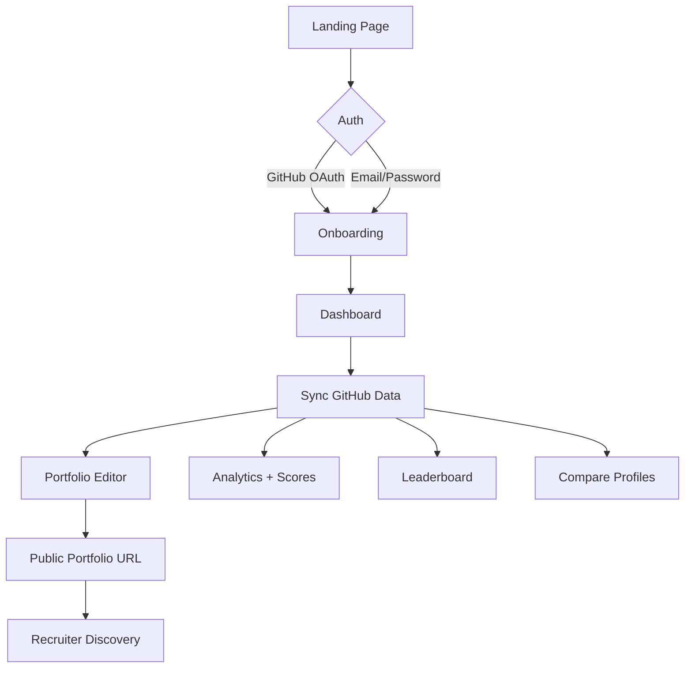
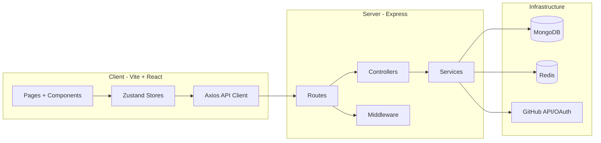

<div align="center">

# DevFolio

Build, showcase, compare, and discover developer portfolios powered by real GitHub activity.

[](client/)
[](server/)
[](documentation/DATABASE_SCHEMA.md)
[](server/src/config/redisClient.js)

[Live Features](#live-features) • [Product Flow](#product-flow) • [Quick Start](#quick-start) • [Deployment](#deployment-guide) • [Architecture](#architecture)

</div>

---

## Why DevFolio Exists

DevFolio helps developers present proof of work, not just claims.

Instead of manually curating portfolio pages, users connect GitHub once and get:
- Automated portfolio building
- Analytics on language, activity, and project depth
- Public profile sharing
- Competitive comparison and leaderboard ranking
- Recruiter-friendly discovery and evaluation

---

## Live Features

### For Developers
- GitHub OAuth login and profile onboarding
- Auto-sync repositories, stars, commits, and contribution signals
- Portfolio editor with customizable content and public preview
- Analytics pages for goals, score trends, and productivity metrics
- Side-by-side profile comparison
- Contest participation and ranking

### For Recruiters and Admins
- Recruiter-focused profile discovery interface
- Candidate signal surface: project quality, consistency, open-source participation
- Leaderboard views and profile filters
- Admin-level monitoring and platform operations views

---

## Product Flow



### User Journey in 6 Steps
1. Sign in and connect identity.
2. Sync GitHub repositories and activity.
3. Configure portfolio appearance and showcased projects.
4. Track goals and analytics from the dashboard.
5. Compare progress with peers and climb leaderboard positions.
6. Share public portfolio URL for recruiter visibility.

---

## Architecture



### Tech Stack

| Layer | Stack |
|---|---|
| Frontend | React 19, Vite, React Router, Tailwind CSS |
| State | Zustand |
| API | Axios with token refresh interceptors |
| Backend | Node.js, Express, MVC architecture |
| Data | MongoDB + Mongoose |
| Cache | Redis |
| Security | Helmet, CORS, CSRF origin checks, rate limiting |
| Auth | JWT access/refresh + GitHub OAuth |

---

## Quick Start

### Prerequisites
- Node.js 18+
- MongoDB (local or Atlas)
- Redis (local or managed)

### 1) Clone

```bash
git clone https://github.com/SubhashKumar14/DevFolio-App.git
cd DevFolio-App
```

### 2) Install Dependencies

```bash
cd server
npm install
cd ../client
npm install
```

### 3) Configure Environment Variables

Create these files:
- `server/.env`
- `client/.env`

Server template:

```env
NODE_ENV=development
PORT=5000

MONGODB_URI=your_mongodb_connection_string
JWT_SECRET=your_access_secret
JWT_REFRESH_SECRET=your_refresh_secret

GITHUB_CLIENT_ID=your_github_client_id
GITHUB_CLIENT_SECRET=your_github_client_secret
GITHUB_CALLBACK_URL=http://localhost:5000/api/auth/github/callback

CLIENT_URL=http://localhost:5173
```

Client template:

```env
VITE_API_URL=http://localhost:5000/api
```

### 4) Run Development Servers

Terminal 1:

```bash
cd server
npm run dev
```

Terminal 2:

```bash
cd client
npm run dev
```

---

## Deployment Guide

DevFolio is already structured for frontend + backend deployment separation.

### Frontend (Vite)
- Build command: `npm run build`
- Output: `client/dist`
- Required env: `VITE_API_URL=https://your-backend-domain/api`

### Backend (Express)
- Start command: `npm start`
- Required envs: `PORT`, `MONGODB_URI`, `JWT_SECRET`, `JWT_REFRESH_SECRET`, `CLIENT_URL`
- CORS origin should match deployed frontend URL via `CLIENT_URL`

### Production Checklist
- Set GitHub OAuth callback to deployed backend callback endpoint
- Set secure secrets for JWT keys
- Enable HTTPS in deployment platform
- Verify CSRF/CORS behavior with production domain
- Confirm Redis connectivity for caching paths

---

## Available Scripts

### Client

| Script | Purpose |
|---|---|
| `npm run dev` | Start Vite dev server |
| `npm run build` | Build production assets |
| `npm run preview` | Preview production build |

### Server

| Script | Purpose |
|---|---|
| `npm run dev` | Start server with nodemon |
| `npm start` | Start server in production mode |
| `npm test` | Run backend tests |

---

## API Surface (High-Level)

Core domains in the backend:
- Auth and OAuth
- Portfolio generation and management
- Profiles and public portfolio views
- Compare and leaderboard
- Contests and scoring
- Integrations and stats

For deeper endpoint details, use:
- `documentation/API_REFERENCE.md`

---

## Repository Layout

```text
DevFolio/
|- client/
|  |- src/
|  |  |- components/
|  |  |- pages/
|  |  |- services/
|  |  |- stores/
|  |  |- lib/
|  |  |- hooks/
|  |  |- App.jsx
|  |  `- main.jsx
|  `- vite.config.js
|- server/
|  `- src/
|     |- config/
|     |- controllers/
|     |- middleware/
|     |- models/
|     |- routes/
|     |- services/
|     |- app.js
|     `- server.js
`- documentation/
```

---

<details>
<summary><strong>Interactive FAQ</strong></summary>

### Is this deployable as separate frontend/backend services?
Yes. The frontend uses `VITE_API_URL` and the backend uses runtime env variables like `PORT` and `CLIENT_URL`.

### Can I run without GitHub OAuth?
Core auth paths can still work, but portfolio auto-sync and recruiter signal quality are strongest with GitHub connected.

### Where should I start exploring in code?
Start with `client/src/App.jsx` for routing and `server/src/app.js` for backend middleware and route mounting.

</details>

---

## Contributing

1. Fork the repository.
2. Create a feature branch: `git checkout -b feature/your-feature-name`.
3. Commit with clear messages.
4. Push and open a pull request.

---

<div align="center">

Built for the developer community.

</div>
