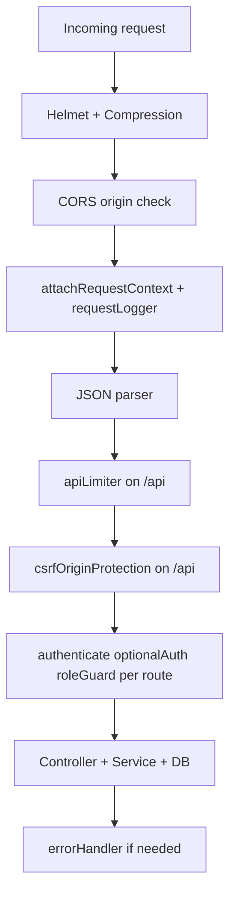
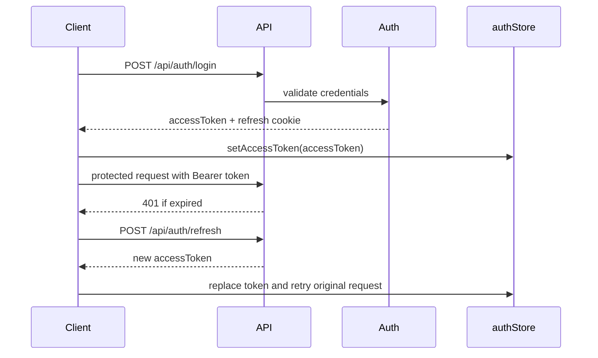
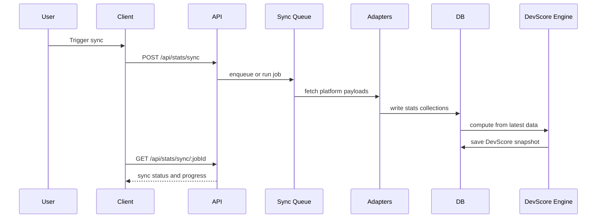
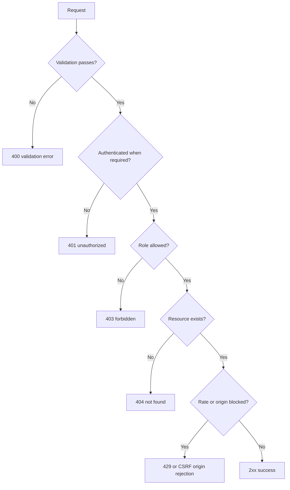

# API Reference (Diagram First)

This reference is organized around route topology, auth flow, sync flow, and endpoint contracts.

## Theoretical Foundation
The API contract is designed using resource-oriented and stateless service principles.

- Contract-first design keeps clients and server behavior stable as features evolve.
- Clear auth boundaries separate public, optional-auth, and protected operations.
- Explicit error semantics improve recoverability and deterministic client behavior.

## 1. API Topology

```mermaid
flowchart LR
  C[Client] --> H[/api/health]
  C --> AUTH[/api/auth/*]
  C --> USER[/api/user/*]
  C --> PROFILE[/api/profile/*]
  C --> INTEGRATIONS[/api/integrations/*]
  C --> STATS[/api/stats/*]
  C --> SCORE[/api/score/*]
  C --> PROJECTS[/api/projects/*]
  C --> PORTFOLIO[/api/portfolio/*]
  C --> LEADERBOARD[/api/leaderboard/*]
  C --> COMPARE[/api/compare/*]
  C --> RECRUITER[/api/recruiter/*]
  C --> ADMIN[/api/admin/*]
  C --> CONTESTS[/api/contests/*]
```

## 2. Middleware Pipeline



## 3. Authentication Token Flow



## 4. Stats Sync and Score Recompute Flow



## 5. Endpoint Matrix

### Public and Optional Auth

| Method | Path | Auth | Role | Notes |
|---|---|---|---|---|
| GET | /api/health | none | public | Health status and timestamp |
| GET | /api/auth/github | none | public | GitHub OAuth redirect |
| GET | /api/auth/github/callback | none | public | GitHub OAuth callback |
| GET | /api/user/search | none | public | Public user search |
| GET | /api/profile/:userId | optionalAuth | public/owner | Profile read with visibility rules |
| GET | /api/portfolio/:identifier | optionalAuth | public/owner | Portfolio read by handle or id |
| GET | /api/leaderboard | optionalAuth | public | Global leaderboard |
| GET | /api/leaderboard/college/:collegeName | optionalAuth | public | College leaderboard |
| GET | /api/score/:userId | optionalAuth | public/owner | Current score snapshot |
| GET | /api/score/:userId/history | optionalAuth | public/owner | Historical scores |
| GET | /api/score/:userId/benchmark | optionalAuth | public/owner | Benchmark payload |
| GET | /api/stats/github/:userId | optionalAuth | public/owner | GitHub stats |
| GET | /api/stats/dsa/:userId | optionalAuth | public/owner | DSA stats |
| GET | /api/stats/platforms/:userId | optionalAuth | public/owner | Other platform stats |
| GET | /api/contests/upcoming | none | public | Contest feed |

### Auth Routes

| Method | Path | Auth | Role | Notes |
|---|---|---|---|---|
| POST | /api/auth/register | none | public | Local registration |
| POST | /api/auth/login | none | public | Local login |
| POST | /api/auth/google | none | public | Google login |
| POST | /api/auth/refresh | none | public | Rotate access token |
| POST | /api/auth/logout | required | any logged-in | Clear session |
| POST | /api/auth/github/link | required | developer/recruiter/admin | Link GitHub account |

### User, Profile, Projects, Portfolio

| Method | Path | Auth | Role | Notes |
|---|---|---|---|---|
| GET | /api/user/me | required | any logged-in | Current user payload |
| PUT | /api/user/me | required | any logged-in | Update base user fields |
| GET | /api/user/export | required | any logged-in | Export user data |
| PUT | /api/profile/me | required | developer/mentor/recruiter/admin | Update profile |
| GET | /api/projects/:userId | required | owner/admin | List projects |
| POST | /api/projects | required | developer/mentor | Create project |
| PUT | /api/projects/:projectId | required | owner/admin | Update project |
| DELETE | /api/projects/:projectId | required | owner/admin | Delete project |
| POST | /api/portfolio | required | developer/mentor | Save portfolio code |
| PATCH | /api/portfolio/visibility | required | developer/mentor | Toggle portfolio visibility |

### Integrations, Stats, Score, Compare

| Method | Path | Auth | Role | Notes |
|---|---|---|---|---|
| POST | /api/integrations/github/connect | required | developer/mentor | Link GitHub integration |
| POST | /api/integrations/dsa/connect | required | developer/mentor | Save DSA handles |
| PATCH | /api/integrations/platforms/:platform/disconnect | required | developer/mentor | Disconnect platform |
| POST | /api/integrations/platforms/:platform/disconnect | required | developer/mentor | Compatibility alias |
| POST | /api/stats/sync | required | developer/mentor/admin | Trigger sync |
| GET | /api/stats/sync/:jobId | required | owner/admin | Poll sync status |
| POST | /api/score/recompute | required | developer/mentor/admin | Recompute score |
| GET | /api/compare/:userId1/:userId2 | required | developer/mentor | Side by side compare |

### Recruiter and Admin

| Method | Path | Auth | Role | Notes |
|---|---|---|---|---|
| GET | /api/recruiter/search | required | recruiter/admin | Candidate search |
| GET | /api/admin/stats | required | admin | Global stats |
| GET | /api/admin/users | required | admin | User management list |
| PATCH | /api/admin/users/:userId/role | required | admin | Change role |
| DELETE | /api/admin/users/:userId | required | admin | Delete user |
| POST | /api/admin/trigger-sync | required | admin | Trigger global sync |
| GET | /api/admin/sync-jobs/:jobId | required | admin | Poll global sync job |

## 6. Error Status and Control Surface



## 7. Contract Invariants

- Response body wraps data through consistent JSON envelope from apiClient usage.
- Refresh endpoint is excluded from retry recursion in client interceptor logic.
- Role isolation is enforced both on frontend route guards and backend roleGuard middleware.
- Optional-auth read routes still enforce owner-or-public visibility checks.