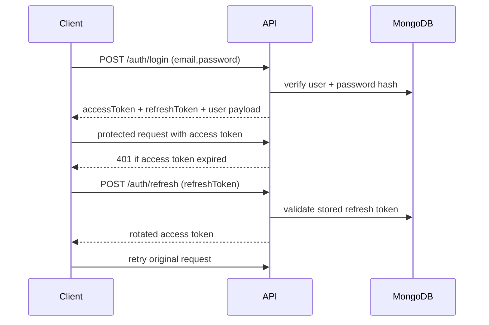
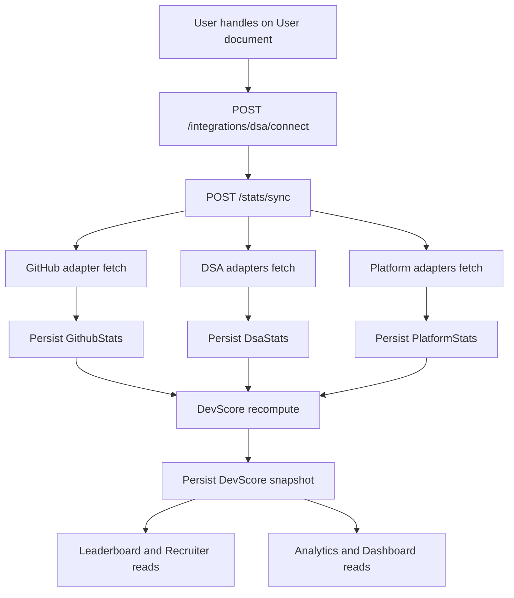

# API Reference

Last updated: 2026-03-29
Base URL (dev): http://localhost:5000/api

## Conventions

- Auth header: Authorization: Bearer <accessToken>
- Refresh token transport: httpOnly cookie (`refreshToken`) scoped to `/api/auth` (legacy body token still accepted for migration)
- Success envelope: { success: true, data: ... }
- Error envelope: { success: false, message: string }
- JSON body limit: 10mb

## Auth and Roles Matrix

| Scope | Requirement |
| --- | --- |
| Public | No token required |
| Optional auth | Token may be provided; request still allowed without token |
| User auth | Valid bearer token required |
| Recruiter auth | Valid token + role in {recruiter, admin} |
| Admin auth | Valid token + role=admin |

## API Lifecycle and Field Flows

### Authentication Token Flow



### Stats Sync to DevScore Flow



### Field Propagation Notes

- `User` platform handles drive adapter request identity.
- Adapter responses map into `GithubStats`, `DsaStats`, and `PlatformStats`.
- Scoring consumes those 3 stats collections and writes a new `DevScore` snapshot.
- Leaderboard, compare, and recruiter endpoints consume the latest score and selected profile fields.

## Route Groups

### Health

| Method | Path | Auth | Description |
| --- | --- | --- | --- |
| GET | /health | Public | API liveness probe |

### Auth

| Method | Path | Auth | Description |
| --- | --- | --- | --- |
| POST | /auth/register | Public | Register user, create profile, issue access token, set refresh cookie |
| POST | /auth/login | Public | Login and issue access token, set refresh cookie |
| POST | /auth/refresh | Public (rate limited) | Rotate access token using refresh cookie (body token accepted for legacy migration) |
| POST | /auth/logout | User | Clear persisted refresh token and refresh cookie |
| GET | /auth/github | Public | Redirect to GitHub OAuth authorize URL |
| GET | /auth/github/callback | Public | OAuth callback exchange and redirect |
| POST | /auth/github/link | User | Link GitHub account using OAuth code |

Register request body:

```json
{
  "email": "dev@example.com",
  "password": "secret123",
  "displayName": "subha",
  "role": "developer"
}
```

Login request body:

```json
{
  "email": "dev@example.com",
  "password": "secret123"
}
```

Refresh request body (legacy fallback; cookie-first flow can use empty body):

```json
{
  "refreshToken": "<jwt-refresh-token>"
}
```

Auth token transport notes:

- access token is returned in JSON response body
- refresh token is stored in an httpOnly cookie (`refreshToken`) scoped to `/api/auth`
- logout clears both persisted refresh token and refresh cookie

### User

| Method | Path | Auth | Description |
| --- | --- | --- | --- |
| GET | /user/me | User | Return current user profile + platform handles |
| PUT | /user/me | User | Update displayName/archetypes/platform handles |
| GET | /user/search | Public | Search public users by displayName prefix/contains |
| GET | /user/export | User | Export current user data package |

Update /user/me allowed fields:

- displayName
- archetype
- secondaryArchetype
- githubUsername
- leetcodeUsername
- codeforcesUsername
- hackerrankUsername
- codechefUsername
- kaggleUsername
- huggingfaceUsername

### Profile

| Method | Path | Auth | Description |
| --- | --- | --- | --- |
| GET | /profile/:userId | Optional auth | Fetch profile by ObjectId/displayName (public profiles, or owner access) |
| PUT | /profile/me | User | Update profile fields and visibility |

PUT /profile/me allowed fields:

- bio
- avatarUrl
- techStack
- socialLinks
- college
- isPublic

Validation notes:

- `avatarUrl` must be a valid `http://` or `https://` URL (or null/empty)
- `socialLinks.{linkedin|website|resumeUrl|twitter}` must be valid `http://` or `https://` URLs when provided

### Integrations

| Method | Path | Auth | Description |
| --- | --- | --- | --- |
| POST | /integrations/dsa/connect | User | Connect/update all supported platform handles |
| POST | /integrations/github/connect | User | GitHub connect path (delegates to auth/link flow) |
| PATCH | /integrations/platforms/:platform/disconnect | User | Soft-disconnect one platform handle (history retained, reconnect later) |
| POST | /integrations/platforms/:platform/disconnect | User | Compatibility alias for disconnect in environments that do not forward PATCH |

PATCH /integrations/platforms/:platform/disconnect path params:

- platform in {github, leetcode, codeforces, hackerrank, codechef, kaggle, huggingface}

Soft-disconnect behavior:

- clears the active handle from User (and GitHub token/id for github)
- does not hard-delete historical stats documents
- user can reconnect later by saving handle again via /integrations/dsa/connect

### Stats

| Method | Path | Auth | Description |
| --- | --- | --- | --- |
| GET | /stats/github/:userId | Optional auth | Return GithubStats for public profile, or owner access |
| GET | /stats/dsa/:userId | Optional auth | Return DsaStats for public profile, or owner access |
| GET | /stats/platforms/:userId | Optional auth | Return PlatformStats for public profile, or owner access |
| POST | /stats/sync | User (sync limiter) | Manual platform sync + devscore recompute |

### Score

| Method | Path | Auth | Description |
| --- | --- | --- | --- |
| GET | /score/:userId | Optional auth | Get latest score for public profile, or owner access |
| GET | /score/:userId/history | Optional auth | Get recent score history (max 30) for public profile, or owner access |
| GET | /score/:userId/benchmark | Optional auth | Get domain benchmark percentile summary for public profile, or owner access |
| POST | /score/recompute | User | Force recompute and persist new score |

### Projects

| Method | Path | Auth | Description |
| --- | --- | --- | --- |
| GET | /projects/:userId | User | Fetch projects for userId (owner-only; admin override) |
| POST | /projects | User | Create project for authenticated user |
| PUT | /projects/:projectId | User | Update own project |
| DELETE | /projects/:projectId | User | Delete own project |

POST /projects body:

```json
{
  "name": "DevFolio",
  "description": "Portfolio scoring app",
  "repoLink": "https://github.com/org/repo",
  "liveUrl": "https://devfolio.app",
  "techStack": ["React", "Node.js", "MongoDB"]
}
```

Validation notes:

- `repoLink` must be a valid GitHub URL when provided
- `liveUrl` must be a valid `http://` or `https://` URL when provided

### Portfolio

| Method | Path | Auth | Description |
| --- | --- | --- | --- |
| GET | /portfolio/:identifier | Optional auth | Fetch portfolio by user ObjectId or displayName |
| POST | /portfolio | User | Save/update rawHtml + sanitized html + css + js |
| PATCH | /portfolio/visibility | User | Toggle public/private visibility |

POST /portfolio body:

```json
{
  "rawHtml": "<div>Hello</div>",
  "cssContent": "body{font-family:sans-serif}",
  "jsContent": "console.log('hello')"
}
```

PATCH /portfolio/visibility body:

```json
{
  "isPublic": true
}
```

### Leaderboard

| Method | Path | Auth | Description |
| --- | --- | --- | --- |
| GET | /leaderboard | Optional auth | Multi-mode leaderboard over public profiles with filters + pagination |
| GET | /leaderboard/college/:collegeName | Optional auth | College-scoped leaderboard over public profiles |

Query params:

- page (default 1)
- limit (default 20)
- mode in {devscore, github, leetcode, codeforces, hackerrank, codechef, kaggle, huggingface}
- college (optional)
- archetype (optional)

### Compare

| Method | Path | Auth | Description |
| --- | --- | --- | --- |
| GET | /compare/:userId1/:userId2 | User | Compare two developers (requires both profiles public, unless requester is owner for that profile) |

Query params:

- platform (defaults devscore)

### Recruiter

| Method | Path | Auth | Description |
| --- | --- | --- | --- |
| GET | /recruiter/search | Recruiter/Admin | Search public developers with scoring filters |

Query params:

- name
- techStack (comma separated)
- college
- minScore
- archetype
- sortBy (devScore or name)

### Admin

| Method | Path | Auth | Description |
| --- | --- | --- | --- |
| GET | /admin/stats | Admin | Platform totals and archetype distribution |
| GET | /admin/users | Admin | Paginated users list |
| PATCH | /admin/users/:userId/role | Admin | Change user role |
| DELETE | /admin/users/:userId | Admin | Delete user and cascaded records |
| POST | /admin/trigger-sync | Admin | Trigger global sync and recompute loop |

### Contests

| Method | Path | Auth | Description |
| --- | --- | --- | --- |
| GET | /contests/upcoming | Public | Cached merged upcoming contest feed |

## Common Error Statuses

| Status | Meaning |
| --- | --- |
| 400 | Validation/business rule error |
| 401 | Missing/invalid token or bad credentials |
| 403 | Forbidden by role/privacy/csrf origin |
| 404 | Resource not found |
| 409 | Duplicate key conflict |
| 429 | Rate limit exceeded |
| 500 | Unexpected server error |

## Security and Middleware Notes

- apiLimiter applies to /api/*
- authLimiter applies to auth route handlers
- syncLimiter applies to /stats/sync
- csrfOriginProtection blocks non-safe requests from disallowed origins
- helmet and cors are globally enabled

## Known Caveats (Current Behavior)

- Some optional-auth read endpoints can expose data that may need tighter privacy checks.
- Refresh token currently travels in request body and is stored client-side.
- Projects read endpoint currently uses route userId rather than strict owner self-scope.

Track remediation in [task.md](./task.md) and [fixes.md](./fixes.md).
