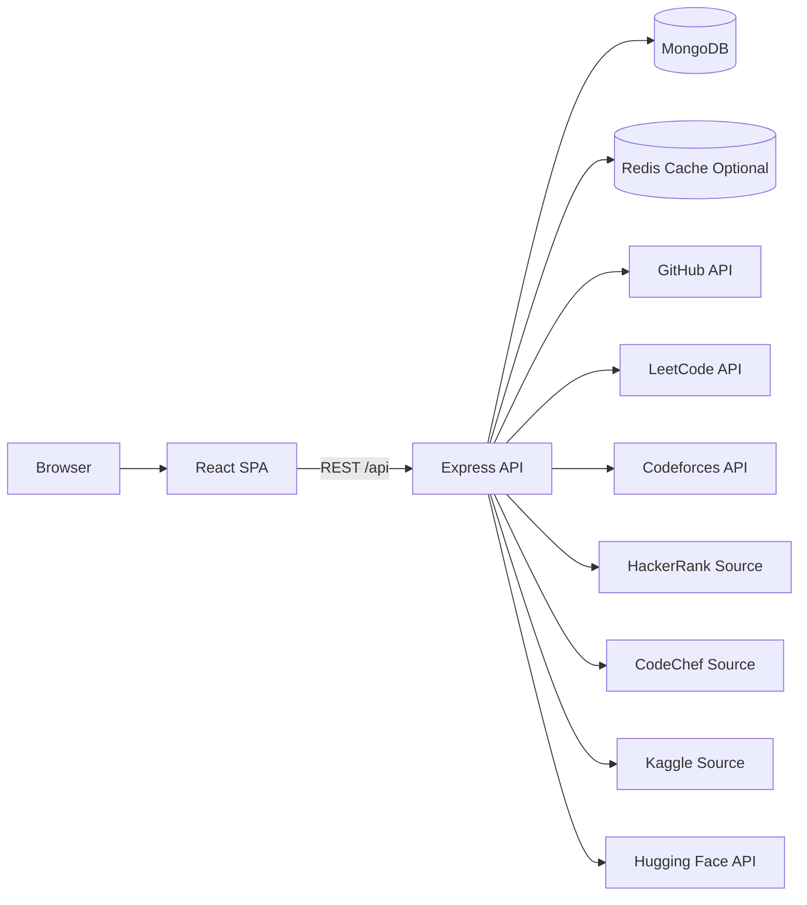
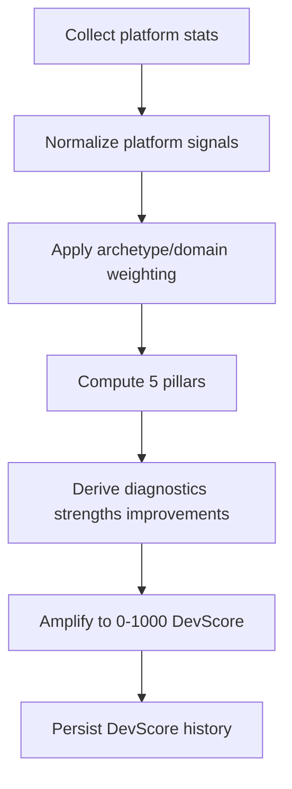

# Architecture

Last updated: 2026-03-29

## System Overview

DevFolio uses a split client/server architecture:

- client: React SPA (routing, UI state, API orchestration)
- server: Express API (auth, business logic, platform sync, scoring, persistence)
- database: MongoDB via Mongoose
- cache: Redis via ioredis (optional in production when REDIS_URL is set)

## Runtime Topology

## Frontend Architecture

### Composition

- Entry: client/src/main.jsx
- Route graph: client/src/App.jsx
- Layout shell:
  - RootLayout for public/no-sidebar flows
  - DashboardLayout for authenticated app shell
- Route protection: ProtectedRoute with optional role filtering support

### State and Data

- Server state: TanStack Query
- Auth/token + session state: Zustand (authStore)
- Theme state: Zustand (themeStore)
- API client: Axios instance with auth header + 401 refresh interceptor

### UI Modules

- Dashboard components: quick stats, streak counter, activity heatmap, platform cards
- Analytics: platform-specific cards/charts/heatmaps
- Portfolio editor: raw code editing + preview iframe pipeline

## Backend Architecture

### App bootstrap

- app.js wires middleware + route prefixes
- server.js connects MongoDB, imports scheduler, starts listener

### Middleware chain

1. helmet
2. cors (origin from CLIENT_URL)
3. body parsers
4. global apiLimiter
5. csrfOriginProtection
6. route handlers
7. errorHandler

### Route domains

- auth
- user/profile
- integrations
- stats/score
- projects/portfolio
- leaderboard/compare
- recruiter/admin
- contests/export/search

## Data Architecture

Core collections:

- User
- Profile
- GithubStats
- DsaStats
- PlatformStats
- DevScore
- Project
- PortfolioCode

Key persistence patterns:

- Profile, GithubStats, DsaStats, PlatformStats, PortfolioCode are 1:1 with userId
- DevScore is append-only history with retention cap (latest 30)
- Project is 1:N from user

## Scoring Pipeline Architecture

Trigger points:

- POST /api/score/recompute
- POST /api/stats/sync
- nightly cron scheduler

## Integration Architecture (Platform Adapters)

Adapter modules in server/src/services:

- githubService.js
- leetcodeService.js
- codeforcesService.js
- hackerrankService.js
- codechefService.js
- kaggleService.js
- huggingfaceService.js
- contestService.js

Pattern:

- fetch platform payload
- normalize shape
- persist into dedicated stats model
- include in buildPlatformData for scoring

## Caching Architecture

- cacheGet helper wraps Redis get/setex with fallback when Redis unavailable
- contests and leaderboard paths use cache read-through
- cache invalidation helper exists but is currently not widely wired into write paths

## Scheduler Architecture

- scheduler imported directly in server.js
- cron runs nightly sync for users with connected handles
- updates stats models + recomputes devscore history

## Security Architecture (Current)

Implemented:

- JWT-based auth
- roleGuard for admin/recruiter paths
- auth/sync/api rate limits
- csrf origin check for non-safe methods
- DOMPurify HTML sanitization for portfolio save path

Known architecture risks:

- token storage strategy still localStorage-centric
- some authorization/privacy checks are not uniformly enforced across all read endpoints
- scheduler import model can duplicate jobs in horizontally scaled deployments

## Cross-References

- [API_REFERENCE.md](./API_REFERENCE.md)
- [DATABASE_SCHEMA.md](./DATABASE_SCHEMA.md)
- [WORKFLOW.md](./WORKFLOW.md)
- [PLATFORM_ADAPTERS.md](./PLATFORM_ADAPTERS.md)
- [devfolio_project_audit.md](./devfolio_project_audit.md)
