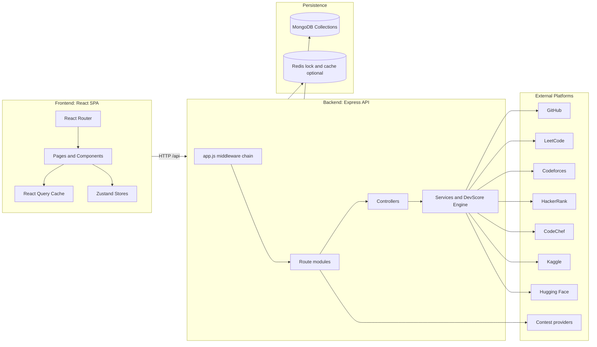
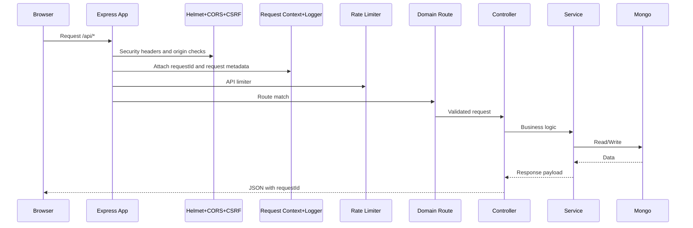
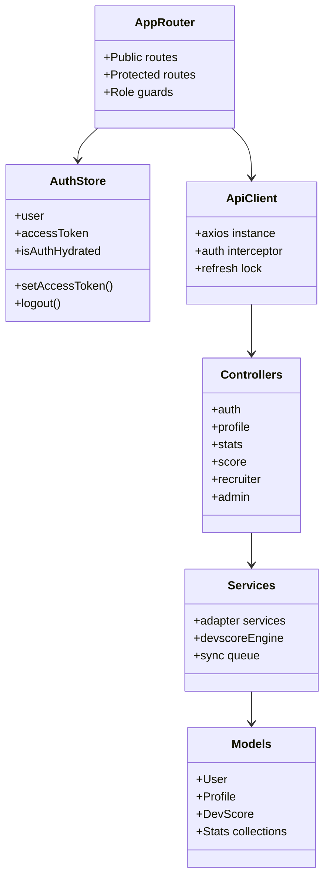
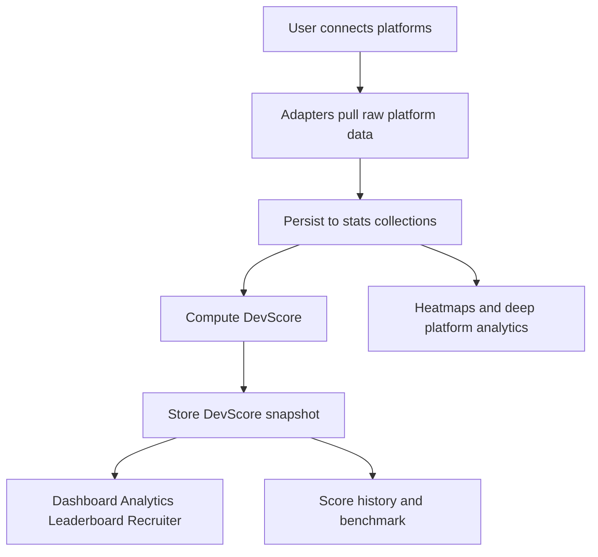
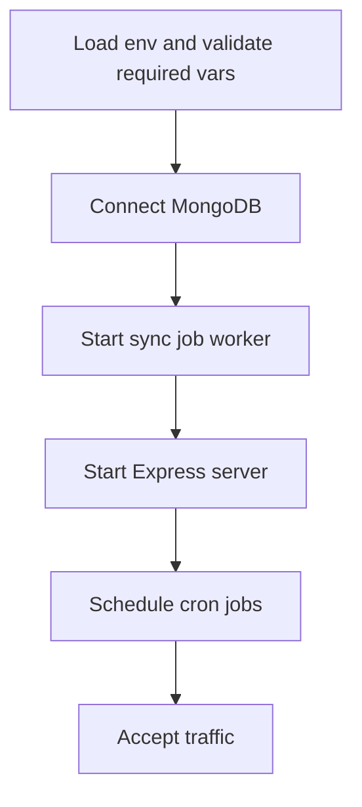
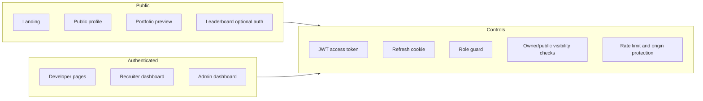

# Architecture (Diagram First)

This document models DevFolio as runtime topology, module boundaries, data flows, and security boundaries.

## Theoretical Foundation
The system architecture applies separation-of-concerns and bounded-context design for maintainability.

- Layering isolates presentation, application, domain, and persistence concerns.
- Adapter boundaries localize external API volatility to service modules.
- Controlled async workflows balance consistency, throughput, and operational safety.

## 1. System Topology

## 2. Request Lifecycle Through Middleware

## 3. Frontend and Backend Module UML

## 4. Data and Scoring Pipeline

## 5. Runtime Startup Topology

## 6. Security Boundary Model

## 7. Architecture Invariants

- Frontend talks only to /api via shared apiClient.
- All protected backend domains use authenticate middleware.
- Role-sensitive routes use explicit roleGuard.
- DevScore persists snapshots and retains bounded history.
- Sync operations can run as queued background jobs.