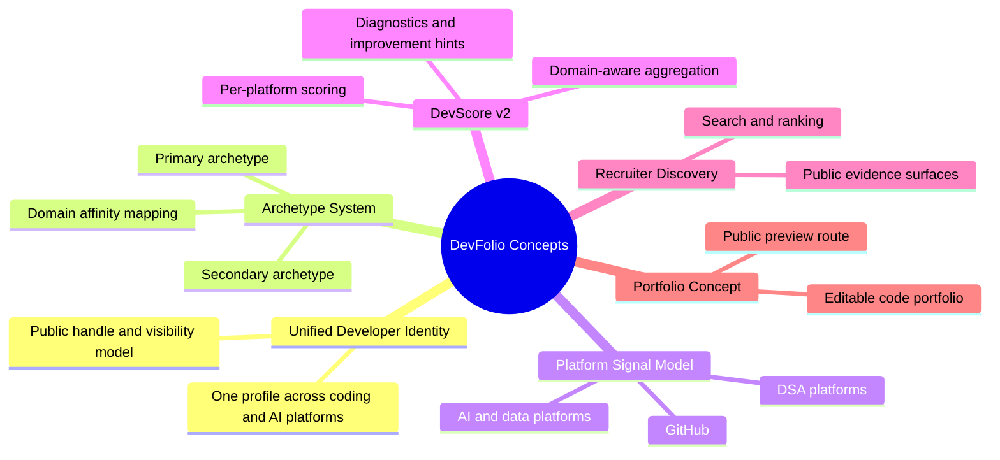
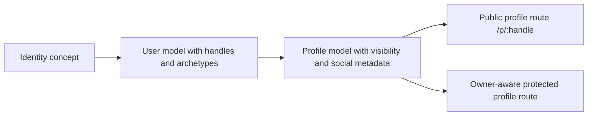
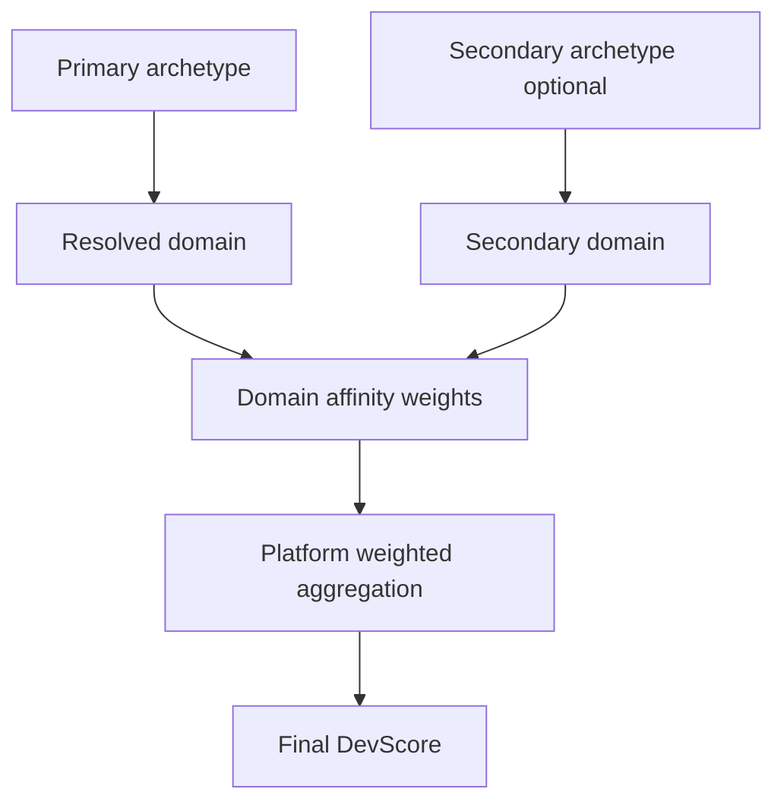
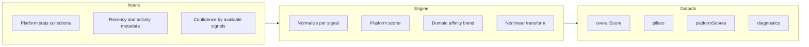
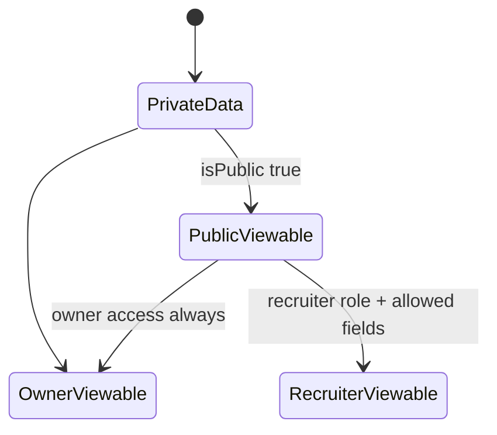
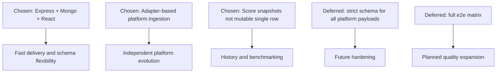
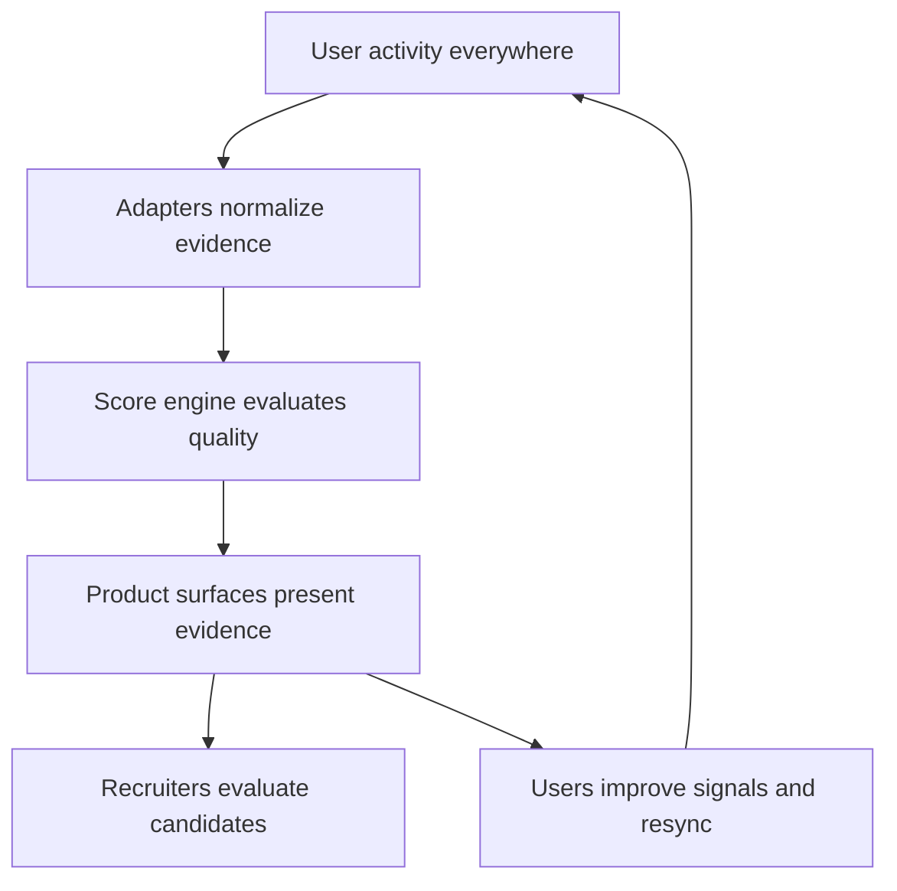

# Concepts and Implementation (Diagram First)

This document captures the product concepts and how they map to implementation modules.

## Theoretical Foundation
Product concepts are modeled as domain abstractions that map directly to implementation modules.

- Domain-driven thinking aligns user intent with persistent business concepts.
- Archetypes behave as weighting lenses, not hard segmentation gates.
- Concept-to-code traceability reduces drift between product language and runtime behavior.

## 1. Product Concept Graph

## 2. Unified Identity Concept To Implementation

## 3. Archetype and Domain Concept Model

## 4. Signal Model Concept

## 5. Privacy and Visibility Concept

## 6. Implementation Decision Map

## 7. Practical Mental Model

## 8. Concept Invariants

- Product value is evidence aggregation, not single-platform ranking.
- Archetype is a weighting lens, not a hard gate.
- Score quality depends on recency, consistency, and breadth.
- Privacy and role rules constrain all read surfaces.