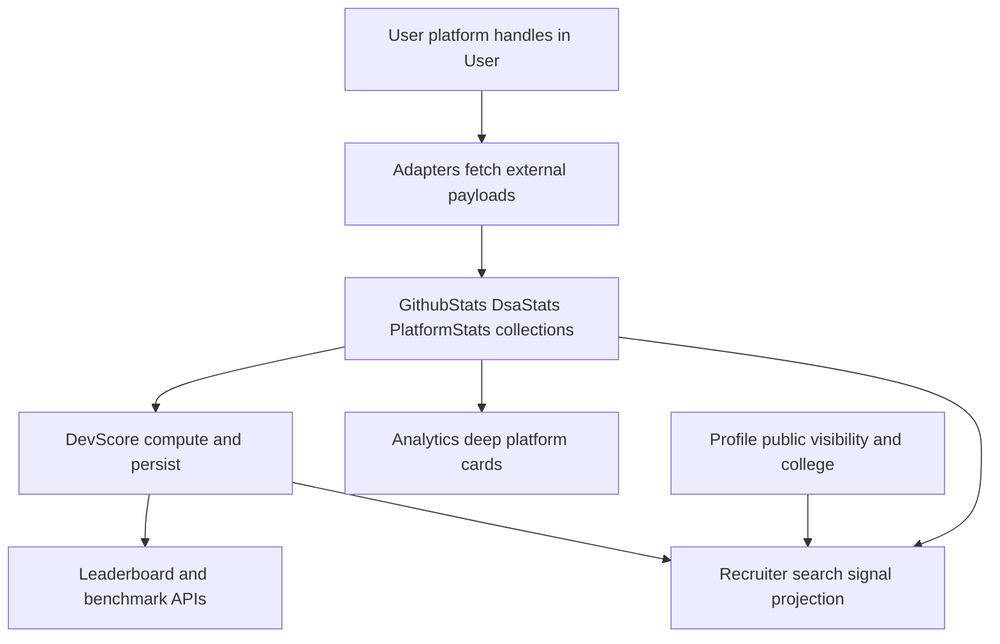
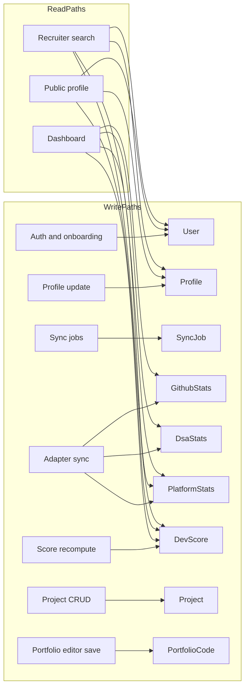
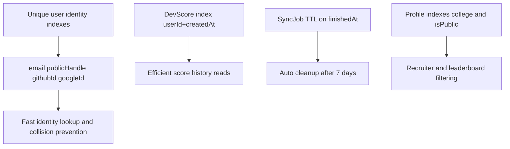

# Database Schema (Diagram First)

This schema view documents entity relationships, lineage, and operational access patterns.

## Theoretical Foundation
The schema strategy balances normalization for integrity and denormalization for read performance.

- One-to-one profile and stats documents preserve clear ownership boundaries.
- Time-series score snapshots enable trend analysis and benchmarking.
- Index design follows cardinality and access-pattern theory for predictable query cost.

## 1. Collection Relationship ER Diagram

```mermaid
erDiagram
  User ||--|| Profile : has
  User ||--|| GithubStats : has
  User ||--|| DsaStats : has
  User ||--|| PlatformStats : has
  User ||--|| PortfolioCode : has
  User ||--o{ Project : owns
  User ||--o{ DevScore : receives
  User ||--o{ SyncJob : requests
  User ||--o{ SyncJob : targets

  User {
    ObjectId _id PK
    string email unique
    string displayName
    string publicHandle unique
    string role
    string archetype
    string secondaryArchetype
    string githubUsername
    string leetcodeUsername
    string codeforcesUsername
    string hackerrankUsername
    string codechefUsername
    string kaggleUsername
    string huggingfaceUsername
    datetime createdAt
    datetime updatedAt
  }

  Profile {
    ObjectId _id PK
    ObjectId userId FK unique
    string bio
    string avatarUrl
    string college
    boolean isPublic
    object socialLinks
    array techStack
    datetime createdAt
    datetime updatedAt
  }

  GithubStats {
    ObjectId _id PK
    ObjectId userId FK unique
    number totalCommits
    number totalContributionsLastYear
    number starsReceived
    number pullRequestsMerged
    array languageDistribution
    array contributionCalendar
    datetime lastSyncedAt
  }

  DsaStats {
    ObjectId _id PK
    ObjectId userId FK unique
    object leetcode
    object codeforces
    datetime lastSyncedAt
  }

  PlatformStats {
    ObjectId _id PK
    ObjectId userId FK unique
    object hackerrank
    object codechef
    object kaggle
    object huggingface
    datetime lastSyncedAt
  }

  DevScore {
    ObjectId _id PK
    ObjectId userId FK
    number score
    number rawScore
    number weightedRawScore
    string domain
    object platformScores
    object diagnostics
    datetime computedAt
    datetime createdAt
  }

  Project {
    ObjectId _id PK
    ObjectId userId FK
    string name
    string description
    string repoLink
    string liveUrl
    array techStack
    number githubStars
    number likes
    number views
  }

  PortfolioCode {
    ObjectId _id PK
    ObjectId userId FK unique
    string rawHtml
    string htmlContent
    string cssContent
    string jsContent
    boolean isPublic
  }

  SyncJob {
    ObjectId _id PK
    string type
    string status
    ObjectId requestedBy FK
    ObjectId targetUserId FK
    number totalTargets
    number processedTargets
    number successCount
    number errorCount
    datetime startedAt
    datetime finishedAt
    object meta
  }
```

## 2. Key Lineage: From Platform Data To Recruiter Surface



## 3. Access Pattern Diagram



## 4. Retention and Indexing Rules



## 5. Integrity Notes

- One-to-one: User with Profile, GithubStats, DsaStats, PlatformStats, PortfolioCode.
- One-to-many: User with Project and DevScore history.
- SyncJob supports both per-user and global sync operations.
- Visibility is enforced by owner-or-public checks, not by a separate public mirror table.