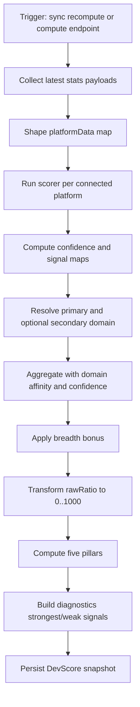
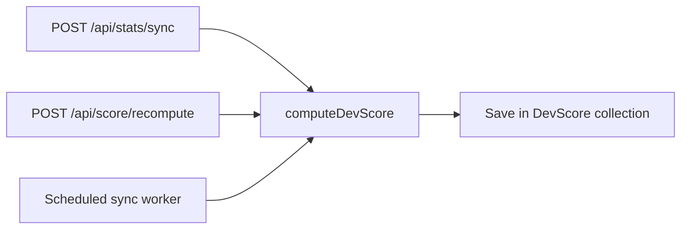
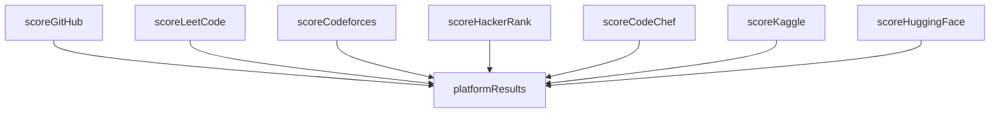
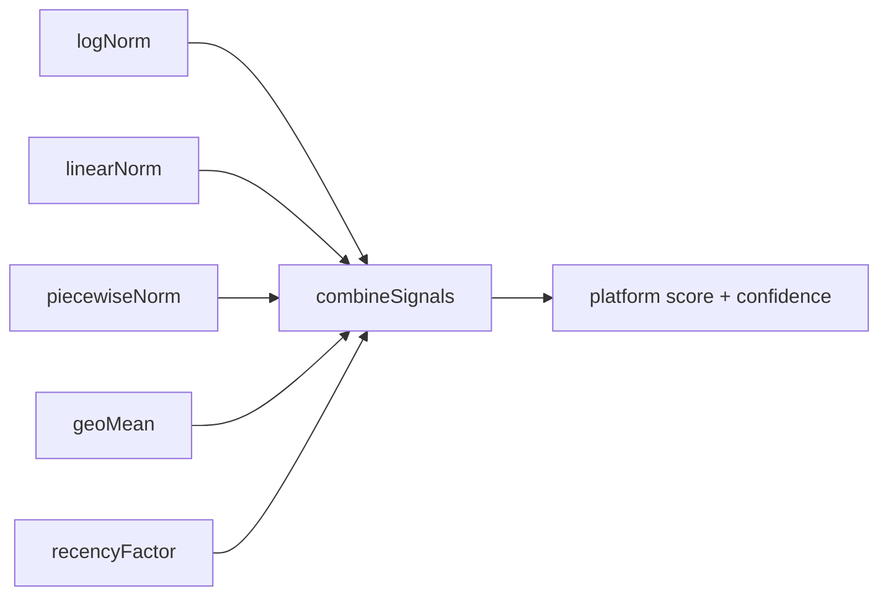
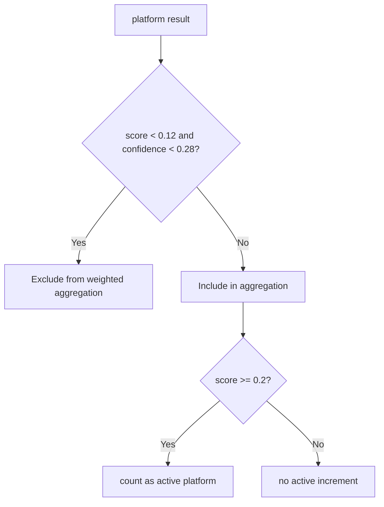
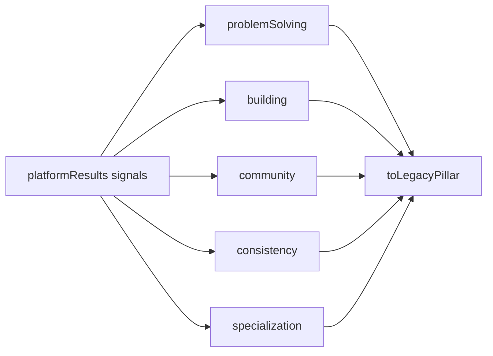
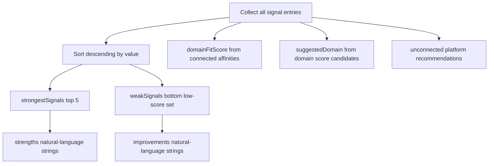
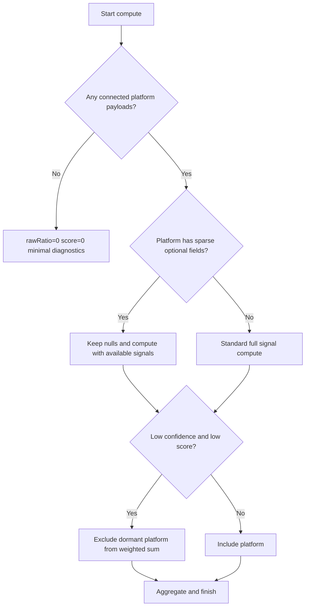
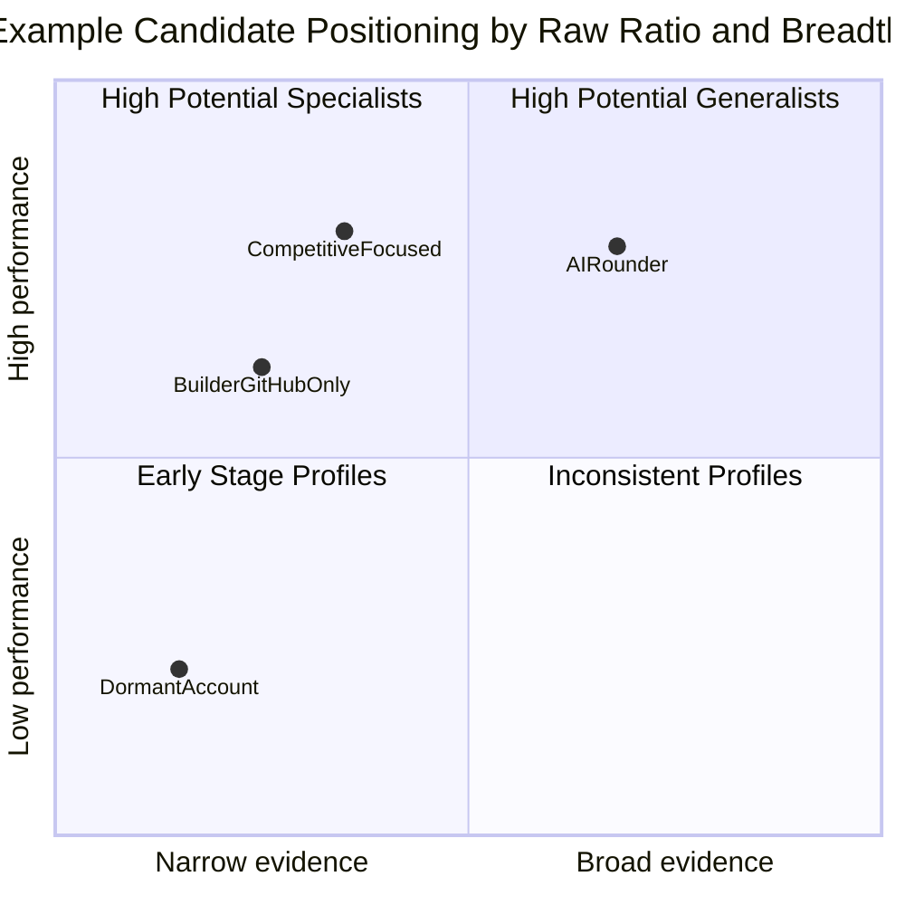
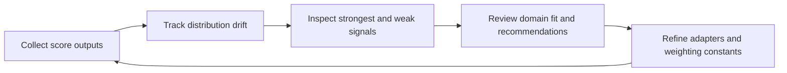

# DevFolio DevScore v2 Algorithm Flow (Diagram First)

This guide gives a detailed, implementation-aligned view of DevScore computation, edge cases, and interpretation.

## Theoretical Foundation
DevScore flow is a multi-criteria decision pipeline with explicit normalization and confidence handling.

- Comparable scoring requires transforming heterogeneous platform signals into a shared scale.
- Confidence-weighted aggregation reduces distortion from sparse or noisy evidence.
- Diagnostics close the loop by turning score outcomes into actionable improvement guidance.

## 1. End-To-End Algorithm Flow



## 2. Trigger Points



## 3. Platform Scoring Subsystem



## 4. Signal Primitive Graph



## 5. Domain Resolution and Affinity Application

```mermaid
flowchart TD
  D1[Input domain or archetype] --> D2[normalizeDomain]
  D2 --> D3[Primary affinity vector]
  D4[Secondary archetype/domain optional] --> D5[Secondary affinity vector]
  D3 --> D6[Blend 70/30 if secondary exists]
  D5 --> D6
  D6 --> D7[effectiveWeight = blendedAffinity * (0.35 + 0.65*confidence)]
  D7 --> D8[weighted sum and normalized weights]
```

## 6. Dormant Signal and Active Platform Rule



## 7. Raw Ratio and Final Score

```mermaid
flowchart TD
  A1[baseScore = weightedSum / totalWeight] --> A2[breadthBonus = min 0.06, 0.015 * activePlatforms-1]
  A2 --> A3[rawRatio = min 1, baseScore + breadthBonus]
  A3 --> A4[overallScore = round(rawRatio^1.15 * 1000)]
  A4 --> A5[grade mapping]
```

## 8. Pillar Derivation Flow



## 9. Diagnostics Construction



## 10. Output Contract Diagram

```mermaid
classDiagram
  class DevScoreResponse {
    +overallScore
    +devScore
    +maxScore
    +rawScore
    +weightedRawScore
    +grade
    +archetype
    +secondaryArchetype
    +domain
    +domainLabel
    +connectedPlatforms
    +pillars
    +strengths[]
    +improvements[]
    +platformScores{}
    +diagnostics{}
    +meta{scoringVersion,timestamp}
  }
```

## 11. Edge Case Decision Tree



## 12. Case Study Map



## 13. Monitoring and Governance Loop



## 14. Implementation Guardrails

- Keep API contract fields stable: overallScore, rawScore, weightedRawScore, pillars, platformScores.
- Keep diagnostics keys stable for analytics and recruiter surfaces.
- Keep null vs zero semantics intact for optional signal fidelity.
- Keep score history retention cap consistent across all write paths.