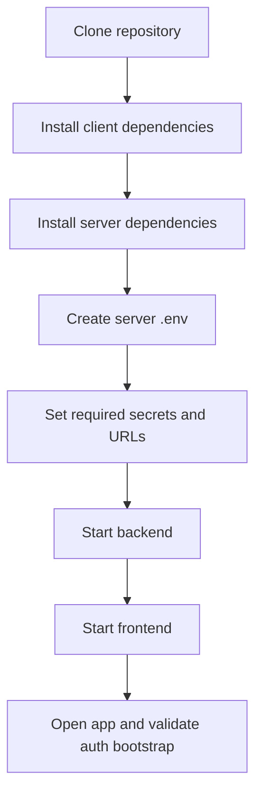
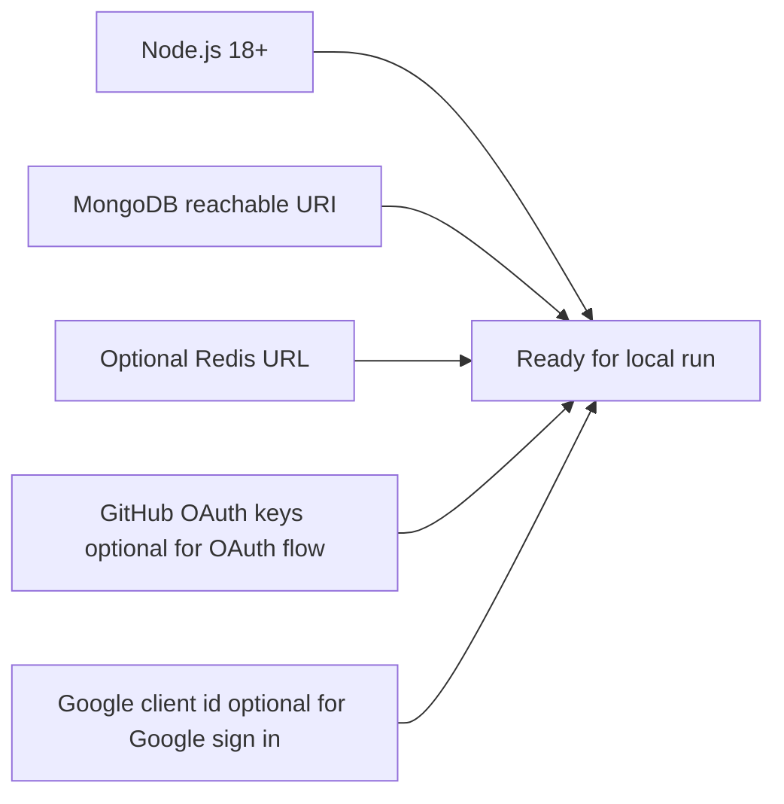
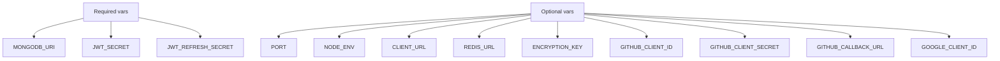
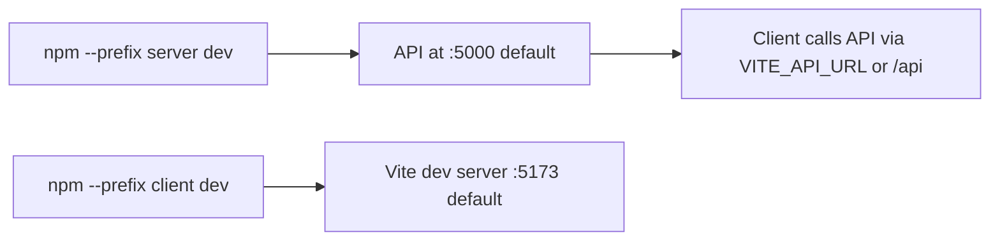
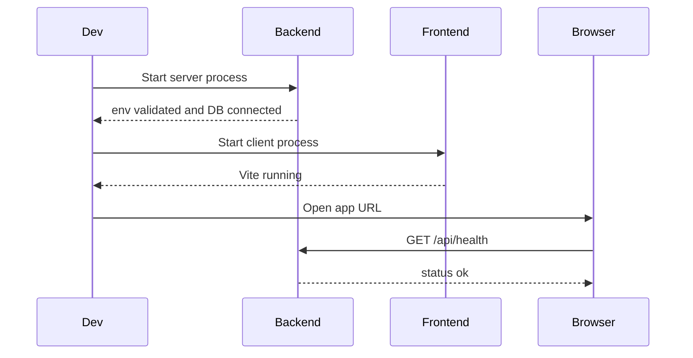
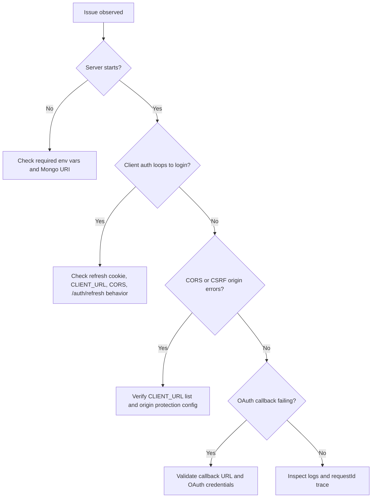
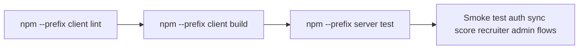

# Environment Setup (Diagram First)

This guide shows local setup, required environment variables, run commands, and troubleshooting flows.

## Theoretical Foundation
Environment setup follows reproducibility and fail-fast configuration principles.

- Externalized configuration supports twelve-factor style deployment consistency.
- Deterministic bootstrap steps reduce machine-specific setup variance.
- Early validation of secrets and endpoints prevents late runtime failures.

## 1. Setup Workflow

## 2. Runtime Prerequisites

## 3. Environment Variable Map

## 4. Local Run Commands

## 5. Verification Flow

## 6. Troubleshooting Decision Tree

## 7. Quality Check Pipeline

## 8. Developer Workflow Recommendation

- Keep two terminals: one for server, one for client.
- Trigger sync after connecting platform handles.
- Validate score and analytics after each adapter-related change.
- Update docs in the same PR as contract or workflow changes.