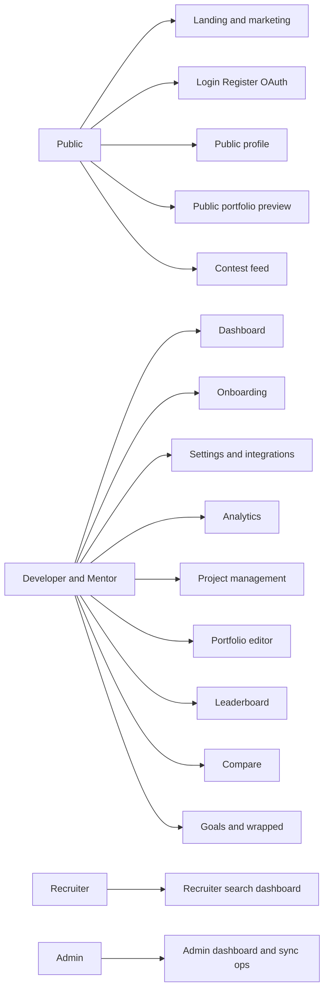
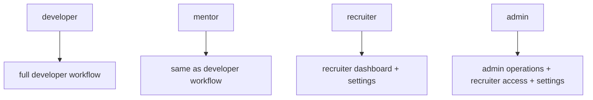
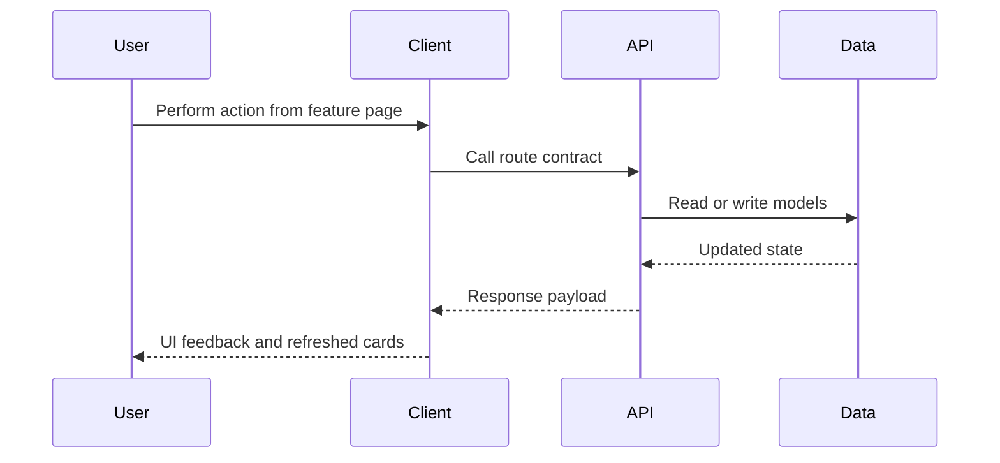
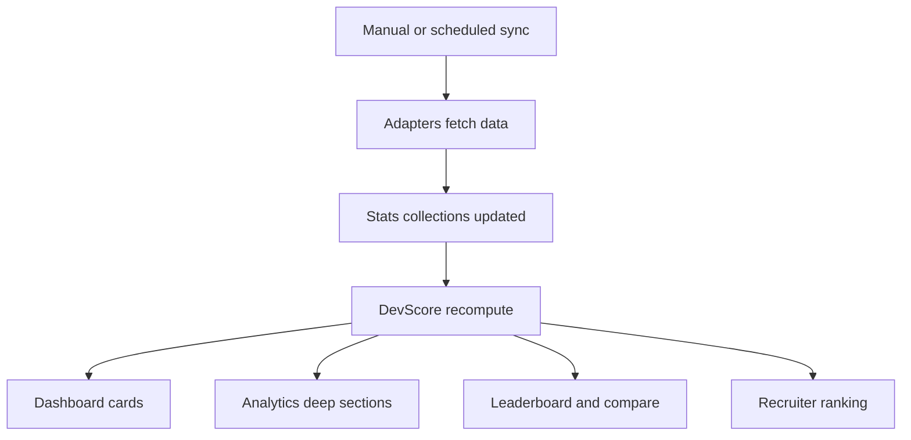
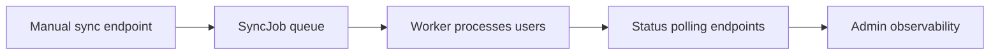
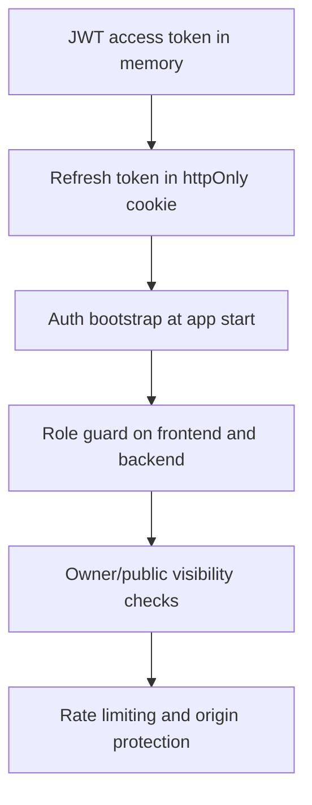

# Features (Diagram First)

This file catalogs product features by role and system capability.

## Theoretical Foundation
Feature modeling is capability-driven and role-aware.

- Role-based surface design ensures each user class gets relevant workflows.
- Capability decomposition supports incremental delivery without breaking core journeys.
- Feature reliability depends on consistency across API, data, and UI boundaries.

## 1. Feature Inventory Graph

## 2. Role Model Diagram

## 3. Feature Lifecycle Flow

## 4. Scoring and Analytics Feature Map

## 5. Operations Feature Map

## 6. Security and Reliability Features

## 7. Backlog and Gaps

- Expand automated e2e feature coverage.
- Add richer recruiter platform filters.
- Continue UX accessibility hardening for all cards and charts.
- Add stronger operational dashboards for sync failures.