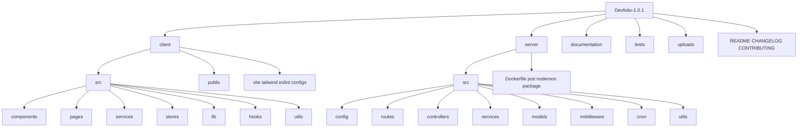
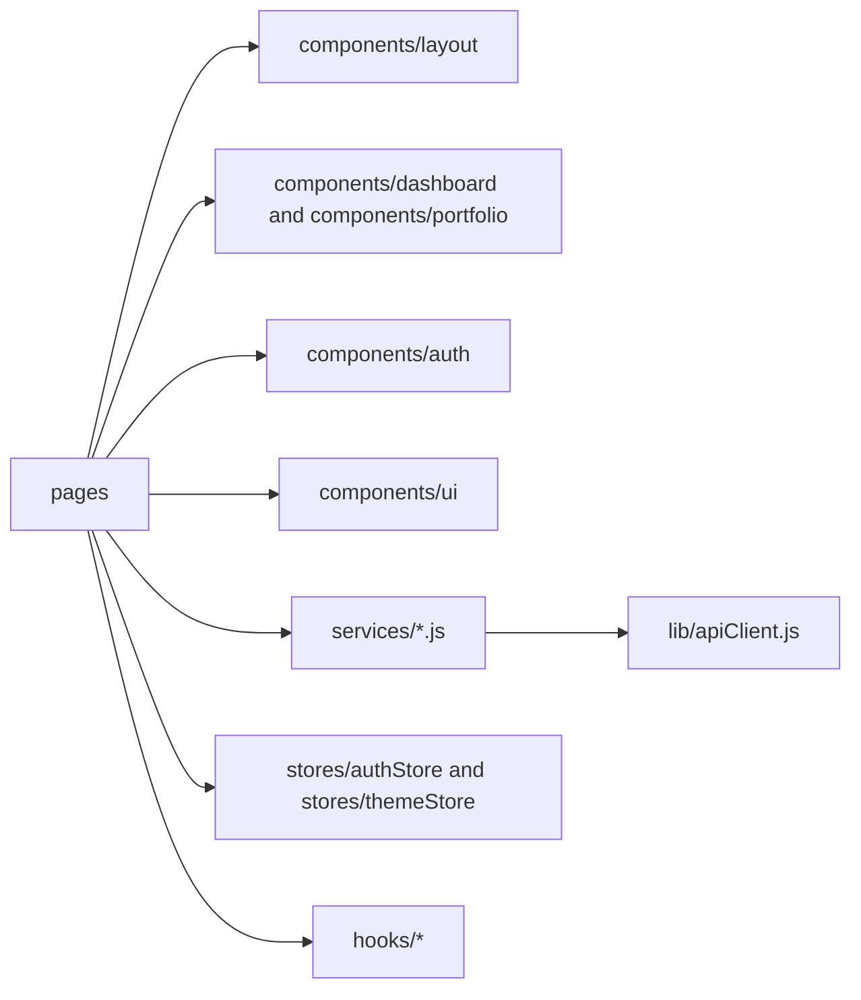
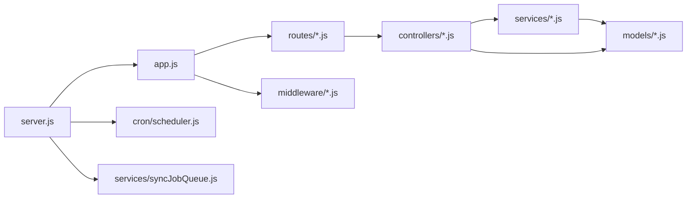
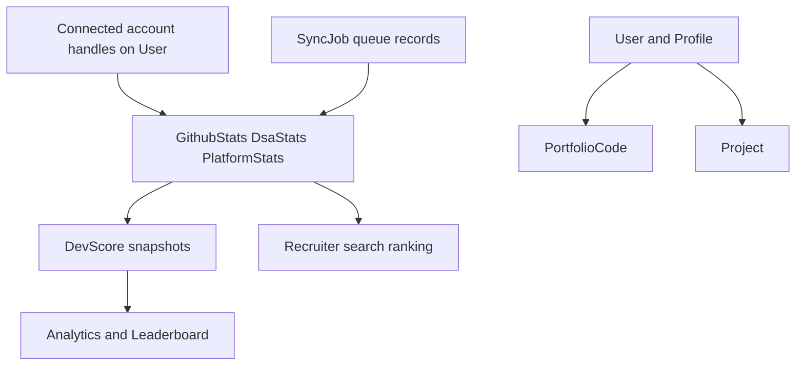
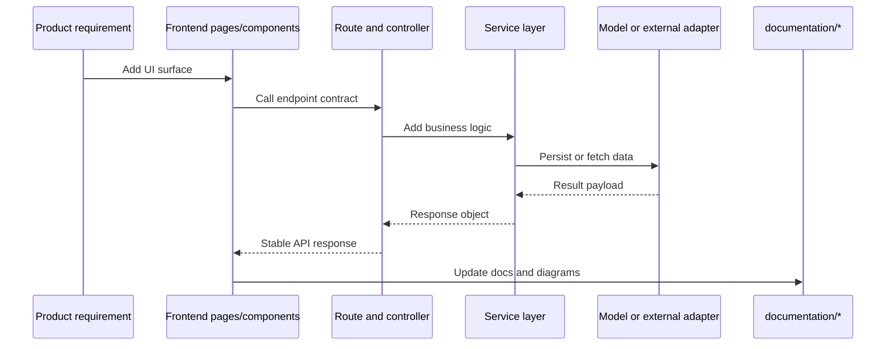

# Folder Structure (Diagram First)

This document explains workspace structure, ownership boundaries, and change flow.

## Theoretical Foundation
Repository structure is organized by cohesion, coupling, and ownership boundaries.

- Domain grouping reduces cognitive load and navigation time.
- Stable interfaces between folders improve parallel team contribution.
- Structure mirrors runtime architecture to simplify traceability from code to behavior.

## 1. High-Level Repository Structure

## 2. Frontend Ownership Map

## 3. Backend Ownership Map

## 4. Data Artifacts and Lifecycles

## 5. Change Flow For New Feature

## 6. Boundary Rules

- Keep route files thin and push behavior to controllers/services.
- Keep component-level API calls in client services and lib/apiClient.
- Keep shared auth logic centralized in authStore and AuthBootstrap.
- Keep schema shape changes mirrored in DATABASE_SCHEMA and API_REFERENCE docs.