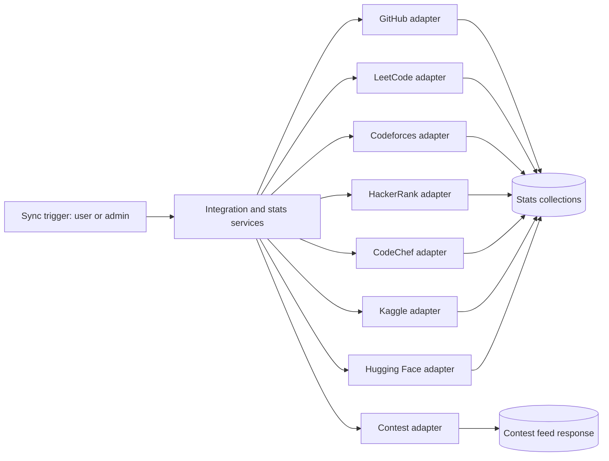
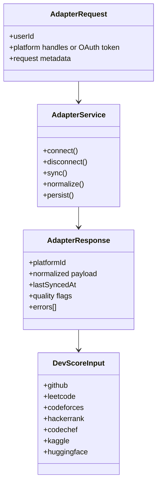
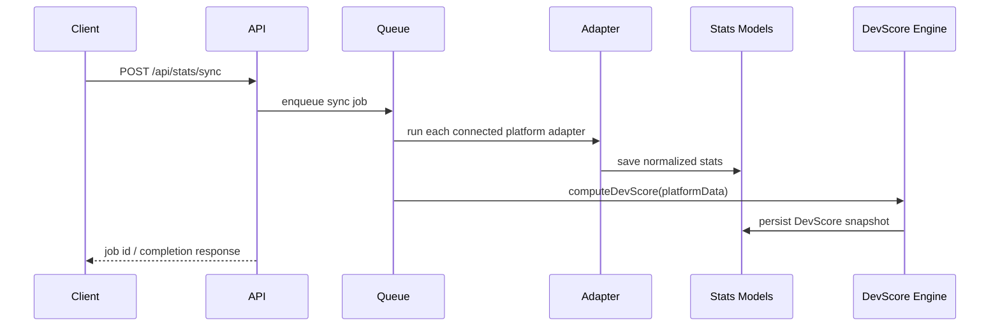
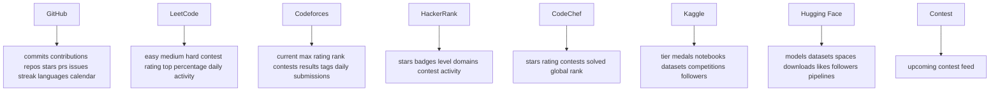
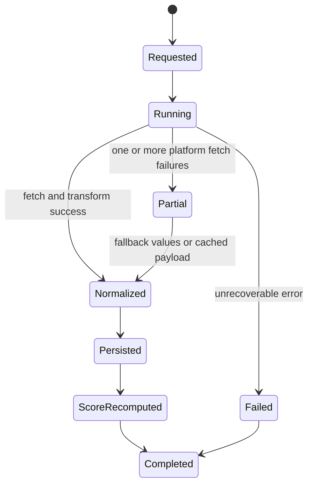

# Platform Adapters (Diagram First)

This document defines adapter architecture, contract, and per-platform flow.

## Theoretical Foundation
Platform integration uses anti-corruption layer and adapter pattern principles.

- External schema volatility is absorbed at the adapter boundary.
- Normalized internal contracts preserve scoring and analytics stability.
- Graceful degradation ensures partial failures do not collapse the full sync pipeline.

## 1. Adapter Architecture

## 2. Adapter Contract UML

## 3. End-To-End Sync Sequence

## 4. Per-Adapter Coverage Diagram

## 5. Error Handling State Model

## 6. Adapter Invariants

- Adapters produce normalized payloads, not UI-formatted responses.
- Missing optional metrics stay null when unknown, not forced to zero.
- Sync can proceed partially and still recompute score from available signals.
- Disconnect supports PATCH and POST aliases for client compatibility.