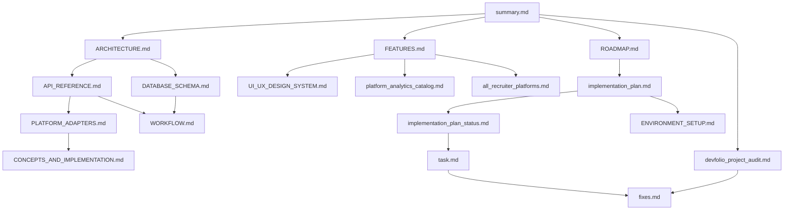

# DevFolio Documentation Hub

Last updated: 2026-03-29
Status: Documentation synchronized with current codebase (frontend + backend + ops)

## Start Here

If this is your first time in the project, read in this order:

1. [summary.md](./summary.md) - one-page project snapshot
2. [ARCHITECTURE.md](./ARCHITECTURE.md) - system design and data flow
3. [FEATURES.md](./FEATURES.md) - everything the product does today
4. [API_REFERENCE.md](./API_REFERENCE.md) - endpoint-level contract
5. [DATABASE_SCHEMA.md](./DATABASE_SCHEMA.md) - model-level persistence contract

## Fast Navigation By Persona

| Persona | Read First | Then |
| --- | --- | --- |
| Frontend engineer | [FEATURES.md](./FEATURES.md) | [UI_UX_DESIGN_SYSTEM.md](./UI_UX_DESIGN_SYSTEM.md), [platform_analytics_catalog.md](./platform_analytics_catalog.md) |
| Backend engineer | [ARCHITECTURE.md](./ARCHITECTURE.md) | [API_REFERENCE.md](./API_REFERENCE.md), [DATABASE_SCHEMA.md](./DATABASE_SCHEMA.md), [PLATFORM_ADAPTERS.md](./PLATFORM_ADAPTERS.md) |
| Product owner | [summary.md](./summary.md) | [ROADMAP.md](./ROADMAP.md), [implementation_plan_status.md](./implementation_plan_status.md) |
| QA / release | [devfolio_project_audit.md](./devfolio_project_audit.md) | [WORKFLOW.md](./WORKFLOW.md), [task.md](./task.md), [fixes.md](./fixes.md) |
| Recruiter module stakeholder | [all_recruiter_platforms.md](./all_recruiter_platforms.md) | [FEATURES.md](./FEATURES.md), [API_REFERENCE.md](./API_REFERENCE.md) |

## Current Product Snapshot

DevFolio is a full-stack developer identity platform with:

- 7 core connected platforms: GitHub, LeetCode, Codeforces, HackerRank, CodeChef, Kaggle, Hugging Face
- DevScore v2 (0-1000), 5-pillar breakdown, archetype-weighted scoring
- Public profile pages, portfolio editor/preview, leaderboard, compare, recruiter search, admin panel
- Role model: developer, recruiter, mentor, admin
- Scheduled sync + manual sync pipeline for external platform stats

## Verified Engineering Status (2026-03-29)

Validation checks executed against current workspace:

- Frontend lint: pass
- Frontend production build: pass
- Backend tests: pass (smoke suite)
- Client production dependency audit: 0 vulnerabilities
- Server production dependency audit: 0 vulnerabilities

See [devfolio_project_audit.md](./devfolio_project_audit.md) for full findings and risk classification.

## Documentation Map

| File | Purpose |
| --- | --- |
| [summary.md](./summary.md) | Executive summary and readiness snapshot |
| [ARCHITECTURE.md](./ARCHITECTURE.md) | Runtime architecture, boundaries, and data flow |
| [API_REFERENCE.md](./API_REFERENCE.md) | Complete API route, auth, request, response details |
| [DATABASE_SCHEMA.md](./DATABASE_SCHEMA.md) | Mongo schema fields, indexes, constraints |
| [FEATURES.md](./FEATURES.md) | Feature inventory by role and surface area |
| [TECH_STACK.md](./TECH_STACK.md) | Dependency and tooling catalog |
| [FOLDER_STRUCTURE.md](./FOLDER_STRUCTURE.md) | Source tree and ownership map |
| [UI_UX_DESIGN_SYSTEM.md](./UI_UX_DESIGN_SYSTEM.md) | Tokens, layout patterns, accessibility considerations |
| [WORKFLOW.md](./WORKFLOW.md) | End-user and backend workflow sequences |
| [ENVIRONMENT_SETUP.md](./ENVIRONMENT_SETUP.md) | Local setup, env vars, runbook |
| [CONCEPTS_AND_IMPLEMENTATION.md](./CONCEPTS_AND_IMPLEMENTATION.md) | Core product concepts and implementation notes |
| [PLATFORM_ADAPTERS.md](./PLATFORM_ADAPTERS.md) | External platform integration adapter details |
| [platform_analytics_catalog.md](./platform_analytics_catalog.md) | Platform analytics dimensions and visualizations |
| [all_recruiter_platforms.md](./all_recruiter_platforms.md) | Recruiter search data model and platform signals |
| [ROADMAP.md](./ROADMAP.md) | Product and engineering roadmap |
| [implementation_plan.md](./implementation_plan.md) | Delivery plan for remaining work |
| [implementation_plan_status.md](./implementation_plan_status.md) | Progress tracking against implementation plan |
| [task.md](./task.md) | Actionable engineering task board |
| [devfolio_project_audit.md](./devfolio_project_audit.md) | Deep pre-deployment audit report |
| [fixes.md](./fixes.md) | Applied fixes and open fix backlog |

## Visual Documentation Navigation

## Practical Reading Paths

### Path A - Understand project in one go (30-45 min)

1. summary
2. architecture
3. features
4. api reference
5. database schema

### Path B - Ship safely (release path)

1. audit
2. fixes
3. tasks
4. implementation plan status
5. environment setup

### Path C - Extend a platform integration

1. platform adapters
2. concepts and implementation
3. api reference (stats + score + integrations)
4. workflow
