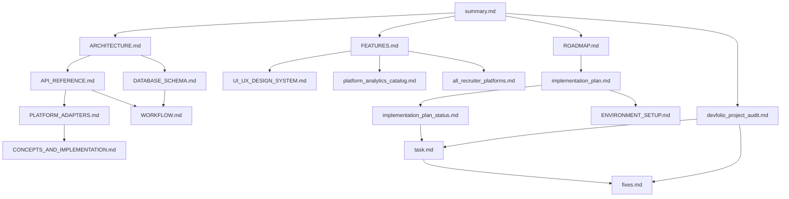

# DevFolio Documentation Hub

Last updated: 2026-04-03
Status: synchronized with current audit cycle (release hardening in progress)

## Start Here

If this is your first time in the project, read in this order:

1. [summary.md](./summary.md) - one-page project snapshot
2. [ARCHITECTURE.md](./ARCHITECTURE.md) - system design and data flow
3. [FEATURES.md](./FEATURES.md) - current product capabilities
4. [API_REFERENCE.md](./API_REFERENCE.md) - endpoint-level contract
5. [DATABASE_SCHEMA.md](./DATABASE_SCHEMA.md) - persistence and indexing contract

## Fast Navigation By Persona

| Persona | Read First | Then |
| --- | --- | --- |
| Frontend engineer | [FEATURES.md](./FEATURES.md) | [UI_UX_DESIGN_SYSTEM.md](./UI_UX_DESIGN_SYSTEM.md), [platform_analytics_catalog.md](./platform_analytics_catalog.md) |
| Backend engineer | [ARCHITECTURE.md](./ARCHITECTURE.md) | [API_REFERENCE.md](./API_REFERENCE.md), [DATABASE_SCHEMA.md](./DATABASE_SCHEMA.md), [PLATFORM_ADAPTERS.md](./PLATFORM_ADAPTERS.md) |
| Product owner | [summary.md](./summary.md) | [ROADMAP.md](./ROADMAP.md), [implementation_plan_status.md](./implementation_plan_status.md) |
| QA / release | [devfolio_project_audit.md](./devfolio_project_audit.md) | [task.md](./task.md), [fixes.md](./fixes.md), [ENVIRONMENT_SETUP.md](./ENVIRONMENT_SETUP.md) |
| Recruiter module stakeholder | [all_recruiter_platforms.md](./all_recruiter_platforms.md) | [FEATURES.md](./FEATURES.md), [API_REFERENCE.md](./API_REFERENCE.md) |

## Current Product Snapshot

DevFolio is a full-stack developer identity platform with:

- 7 connected platforms: GitHub, LeetCode, Codeforces, HackerRank, CodeChef, Kaggle, Hugging Face
- DevScore v2 (0-1000), 5-pillar scoring, archetype weighting
- Public profile pages, portfolio editor/preview, leaderboard, compare, recruiter search, admin panel
- role model: developer, recruiter, mentor, admin
- manual + scheduled sync workflows for external platform analytics

## Verified Engineering Status (2026-04-03)

Validation checks executed against current workspace:

- frontend lint: pass
- frontend production build: pass
- backend tests: pass (`2` suites, `9` tests)
- client production dependency audit: `0` vulnerabilities
- server production dependency audit: `0` vulnerabilities
- backend startup in clean env: **fails** without complete env bootstrap alignment (`MONGODB_URI` missing)

See [devfolio_project_audit.md](./devfolio_project_audit.md) for full findings and risk classification.

## Release Readiness Snapshot

- recommendation: **conditional no-go** for full production launch
- blockers: see P0 tasks in [task.md](./task.md)
- progress tracking: [implementation_plan_status.md](./implementation_plan_status.md)
- completed fixes and validated deltas: [fixes.md](./fixes.md)

## Documentation Map

| File | Purpose |
| --- | --- |
| [summary.md](./summary.md) | Executive summary and readiness snapshot |
| [ARCHITECTURE.md](./ARCHITECTURE.md) | Runtime architecture, boundaries, and data flow |
| [API_REFERENCE.md](./API_REFERENCE.md) | API contracts, auth model, request/response details |
| [DATABASE_SCHEMA.md](./DATABASE_SCHEMA.md) | Mongo schema, indexes, data constraints |
| [FEATURES.md](./FEATURES.md) | Feature inventory by role and UI surface |
| [TECH_STACK.md](./TECH_STACK.md) | Dependency and tooling catalog |
| [FOLDER_STRUCTURE.md](./FOLDER_STRUCTURE.md) | Source tree and ownership map |
| [UI_UX_DESIGN_SYSTEM.md](./UI_UX_DESIGN_SYSTEM.md) | UI tokens, patterns, accessibility guidelines |
| [WORKFLOW.md](./WORKFLOW.md) | End-user and backend workflow sequences |
| [ENVIRONMENT_SETUP.md](./ENVIRONMENT_SETUP.md) | Local setup, environment variables, runbook |
| [CONCEPTS_AND_IMPLEMENTATION.md](./CONCEPTS_AND_IMPLEMENTATION.md) | Core product concepts and implementation notes |
| [PLATFORM_ADAPTERS.md](./PLATFORM_ADAPTERS.md) | External platform adapter details |
| [platform_analytics_catalog.md](./platform_analytics_catalog.md) | Platform analytics dimensions and visualizations |
| [all_recruiter_platforms.md](./all_recruiter_platforms.md) | Recruiter search signal inventory |
| [ROADMAP.md](./ROADMAP.md) | Product and engineering roadmap |
| [implementation_plan.md](./implementation_plan.md) | Delivery and hardening plan |
| [implementation_plan_status.md](./implementation_plan_status.md) | Current status against the plan |
| [task.md](./task.md) | Actionable engineering task board |
| [devfolio_project_audit.md](./devfolio_project_audit.md) | Full pre-deployment audit report |
| [fixes.md](./fixes.md) | Applied fixes and historical change log |

## Visual Documentation Navigation

## Practical Reading Paths

### Path A - Understand project quickly (30-45 min)

1. summary
2. architecture
3. features
4. API reference
5. database schema

### Path B - Release hardening path

1. audit
2. task board
3. implementation status
4. fixes log
5. environment setup

### Path C - Extend a platform integration

1. platform adapters
2. concepts and implementation
3. API reference (stats + score + integrations)
4. workflow
