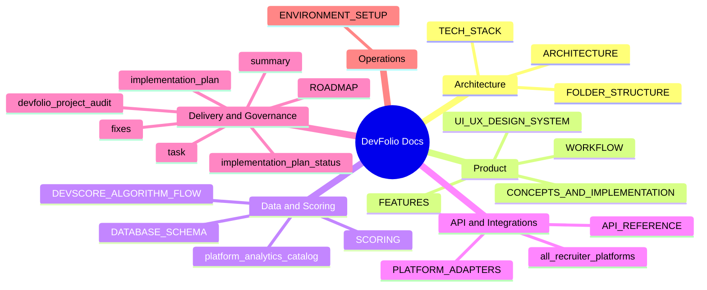
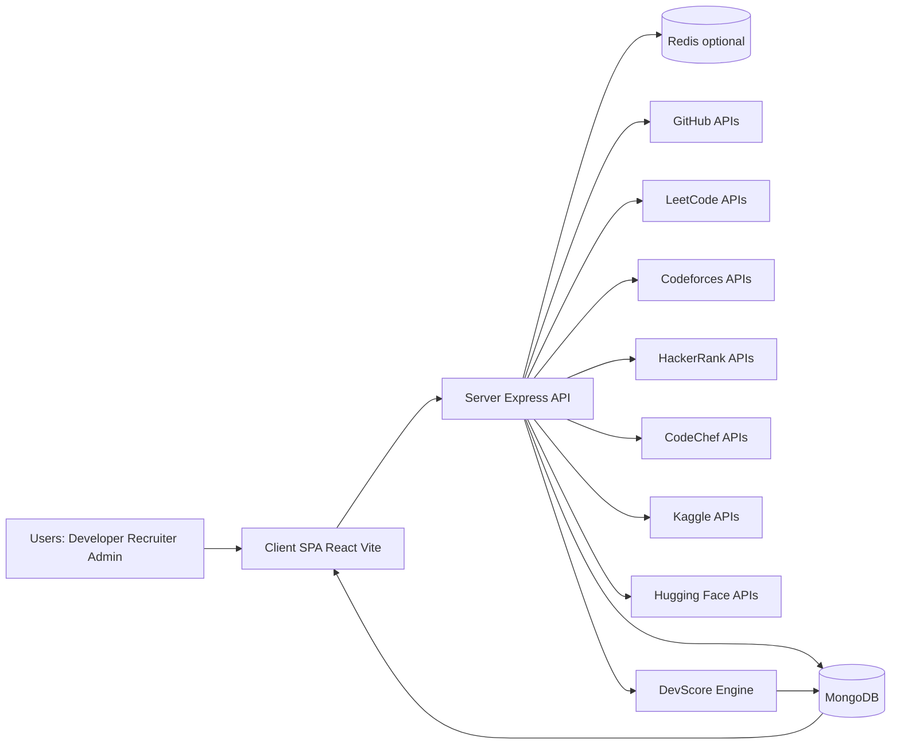
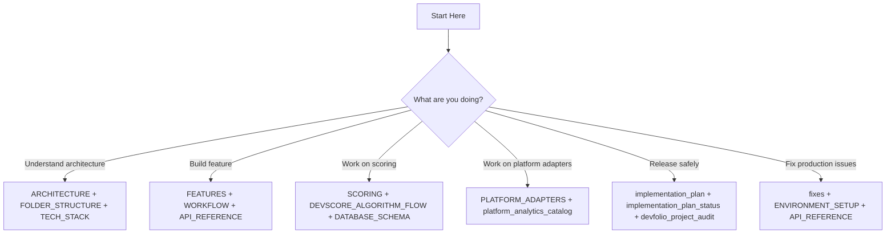

# DevFolio Documentation Hub (Diagram First)

This documentation set is rewritten to be diagram-centric. Use this page as the navigation map.

## Theoretical Foundation
DevFolio documentation follows a multimodal knowledge model where diagrams and prose work together to reduce onboarding time and ambiguity.

- Diagram-first structure supports rapid mental model construction.
- Theoretical narrative captures assumptions, invariants, and trade-offs behind each diagram.
- Cross-document traceability keeps architecture, API, data, and delivery theory aligned.

## Documentation Map

## System Snapshot

## Read Path By Persona

## Coverage Matrix

| Domain | Primary Docs |
|---|---|
| System design | ARCHITECTURE.md, FOLDER_STRUCTURE.md, TECH_STACK.md |
| Product and UX | FEATURES.md, UI_UX_DESIGN_SYSTEM.md, WORKFLOW.md |
| Data and score | DATABASE_SCHEMA.md, SCORING.md, DEVSCORE_ALGORITHM_FLOW.md |
| API and adapters | API_REFERENCE.md, PLATFORM_ADAPTERS.md |
| Recruiter intelligence | all_recruiter_platforms.md, platform_analytics_catalog.md |
| Delivery and audit | implementation_plan.md, implementation_plan_status.md, task.md, fixes.md, devfolio_project_audit.md, ROADMAP.md, summary.md |
| Local and deployment ops | ENVIRONMENT_SETUP.md |