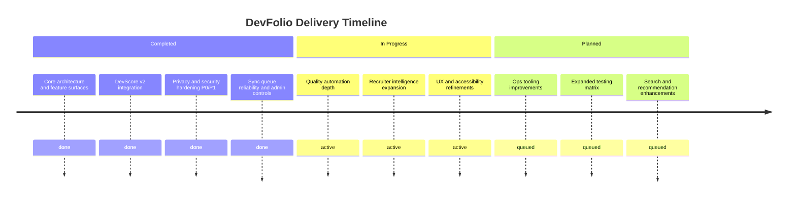
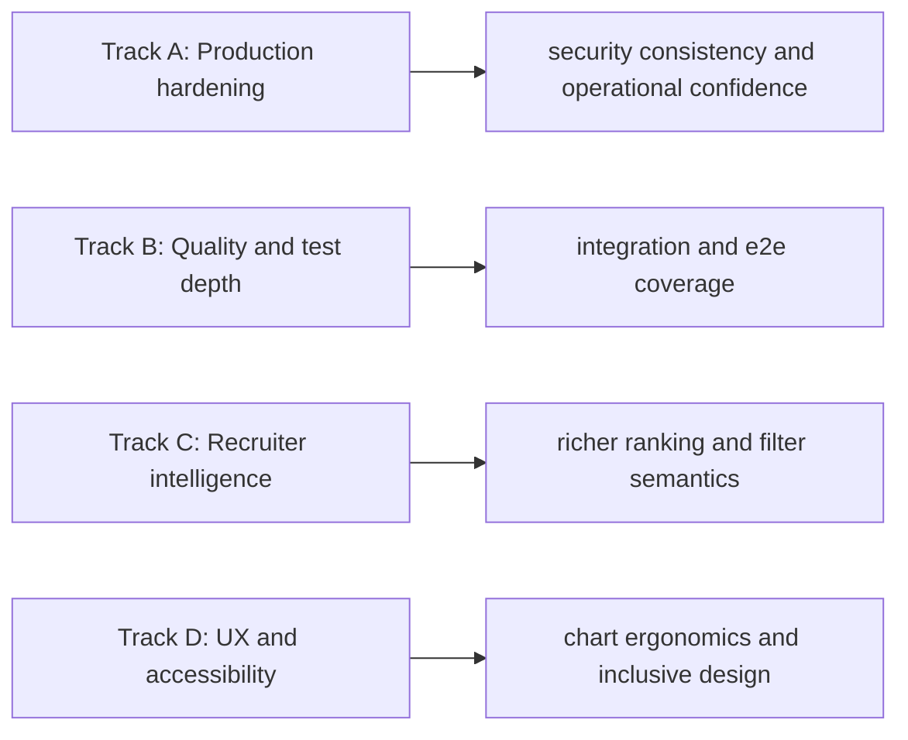
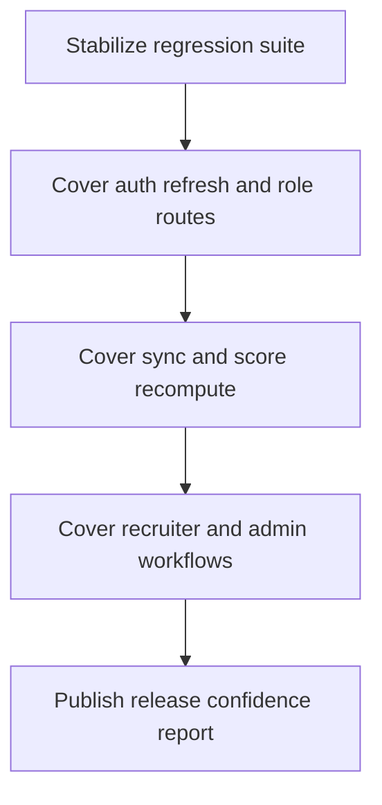
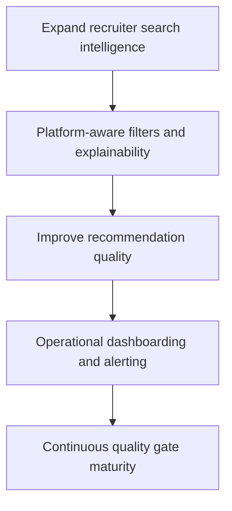
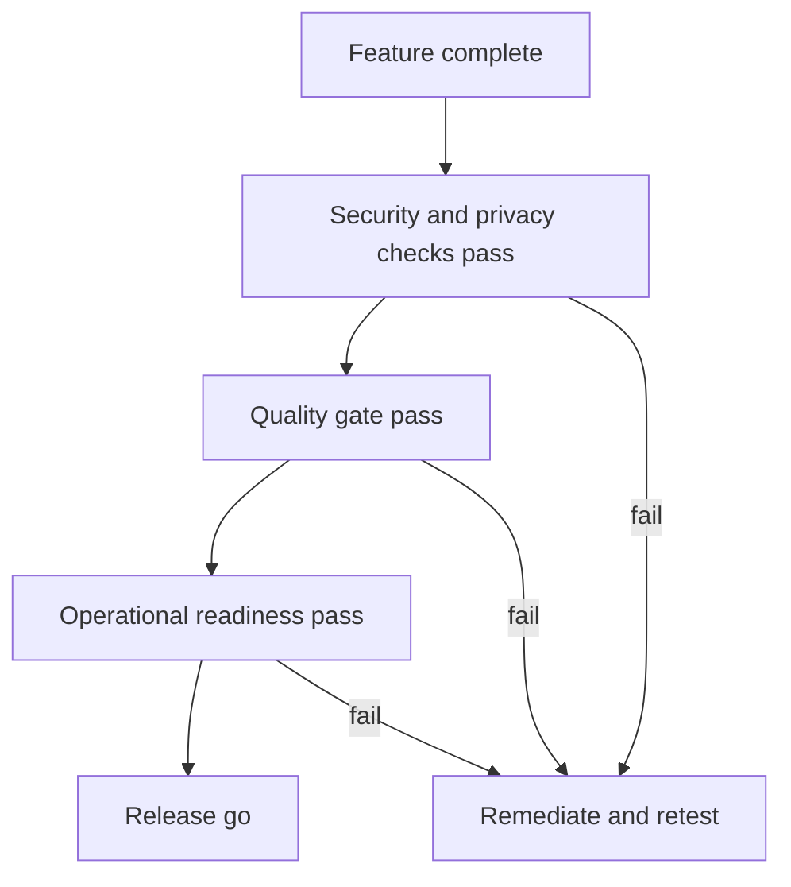
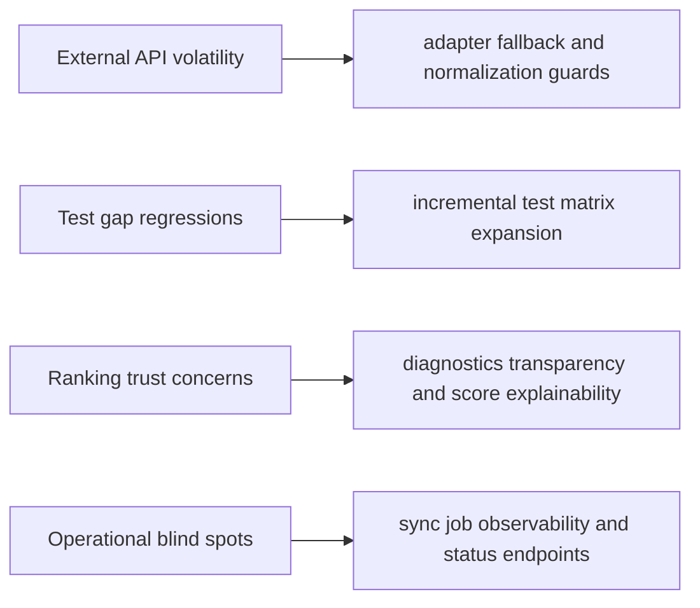

# Roadmap (Diagram First)

This roadmap visualizes completed milestones, active tracks, and near-term plans.

## Theoretical Foundation
Roadmapping is outcome-oriented and uncertainty-aware.

- Time horizons represent confidence bands, not deterministic promises.
- Track-based planning separates foundational risk from feature expansion.
- Decision gates maintain strategic focus under changing constraints.

## 1. Milestone Timeline

## 2. Priority Tracks

## 3. Next 30 Day Plan

## 4. Next 60-90 Day Plan

## 5. Decision Gate Model

## 6. Strategic Risks and Mitigations

