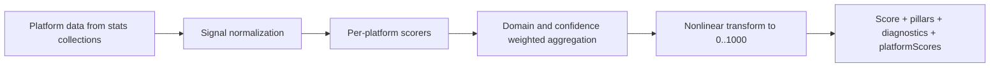
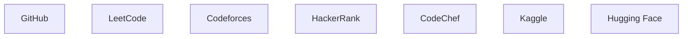
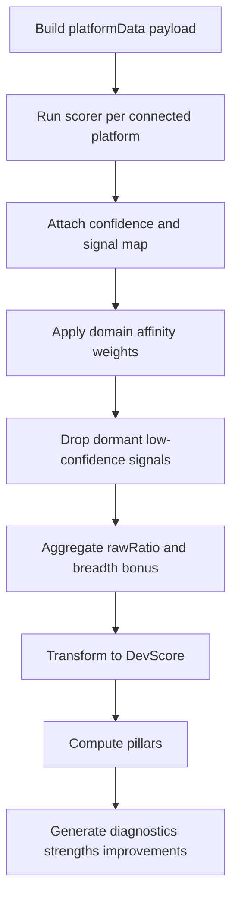
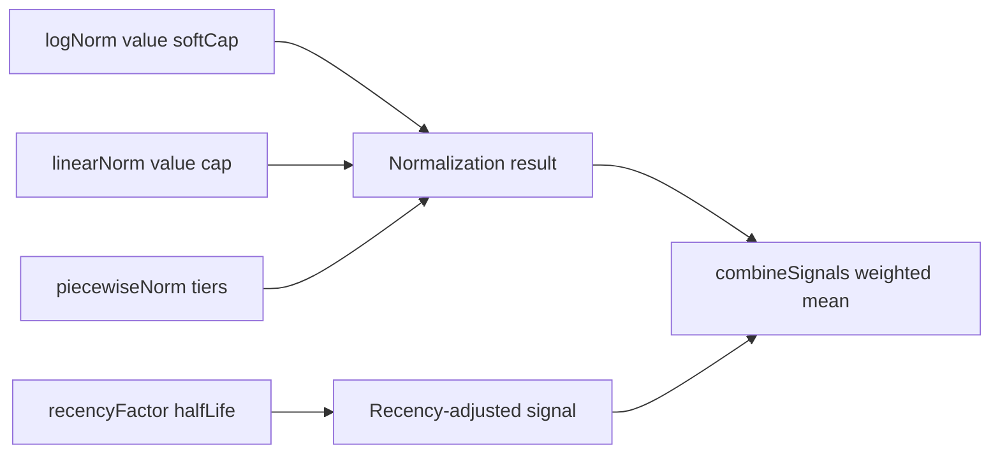
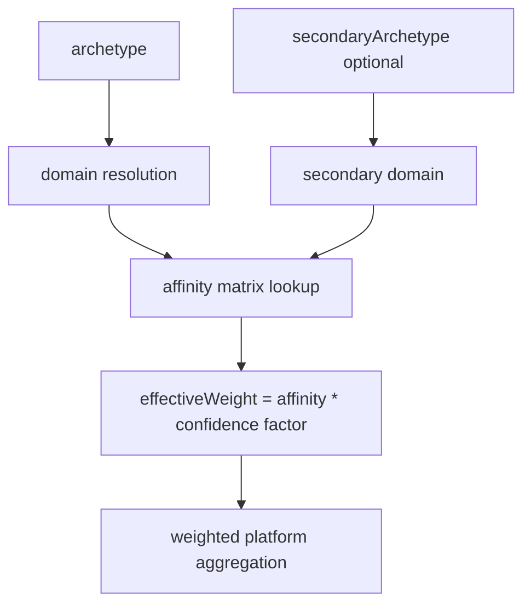
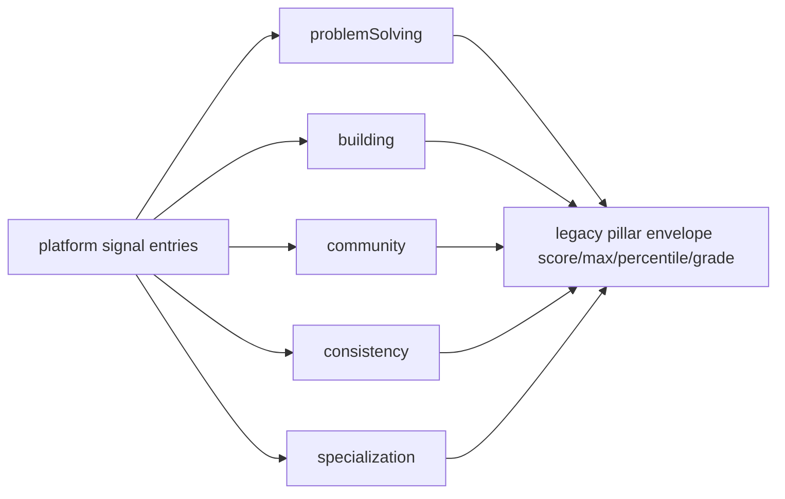
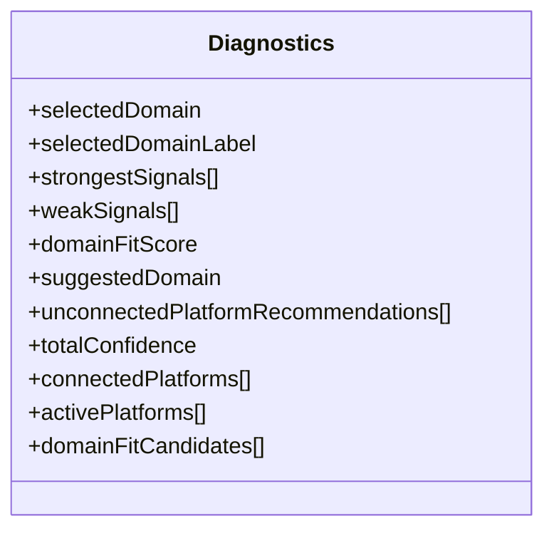

# DevScore v2.0 Scoring Documentation (Diagram First)

This document captures the scoring architecture, math primitives, domain weighting, and output contracts.

## Theoretical Foundation
Scoring is grounded in multi-criteria evaluation and explainable ranking theory.

- Signal normalization is required for fair cross-platform comparison.
- Weighted aggregation should reflect both domain relevance and evidence quality.
- Explainability outputs are first-class to preserve trust in ranking outcomes.

## 1. Scoring Architecture



## 2. Supported Platforms



## 3. Pipeline Steps



## 4. Core Math Primitives



## 5. Domain and Archetype Model



## 6. Pillar Construction



## 7. Final Score and Grade

```mermaid
flowchart TD
  R[rawRatio in 0..1] --> T[score = round((rawRatio^1.15)*1000)]
  T --> G{grade mapping}
  G --> GS[S >= 920]
  G --> GA[A+ >= 820]
  G --> GB[A >= 700]
  G --> GC[B+ >= 580]
  G --> GD[B >= 450]
  G --> GE[C+ >= 300]
  G --> GF[C >= 180]
  G --> GG[D otherwise]
```

## 8. Diagnostics Contract



## 9. Output Envelope

| Field | Meaning |
|---|---|
| overallScore | Final DevScore 0..1000 |
| rawScore | Pre-transform ratio scaled to 0..100 |
| weightedRawScore | Current weighted raw score (0..100) |
| pillars | Five-pillar legacy-compatible object |
| platformScores | Per-platform score, confidence, normalized weight |
| strengths | Top positive signals in readable text |
| improvements | Weak areas and connect-platform recommendations |
| diagnostics | Deep explainability payload |

## 10. Guardrails

- Keep legacy pillar envelope shape to avoid frontend regressions.
- Preserve platformScores fields expected by analytics and compare surfaces.
- Do not force absent optional platform metrics to zero during normalization.
- Keep score history bounded by retention policy in write paths.