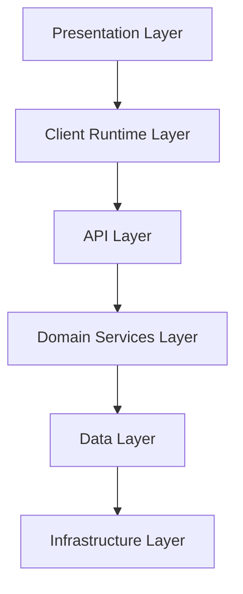
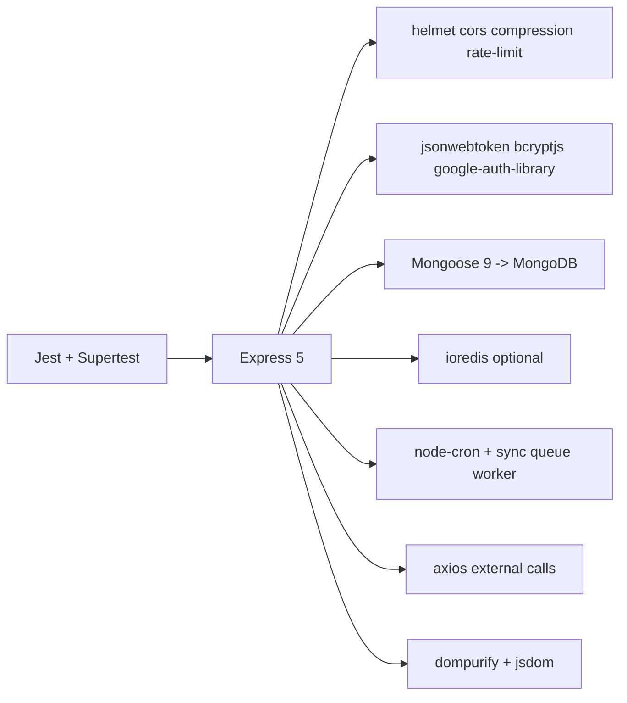
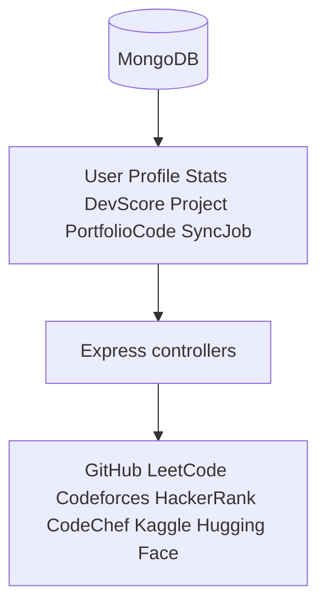
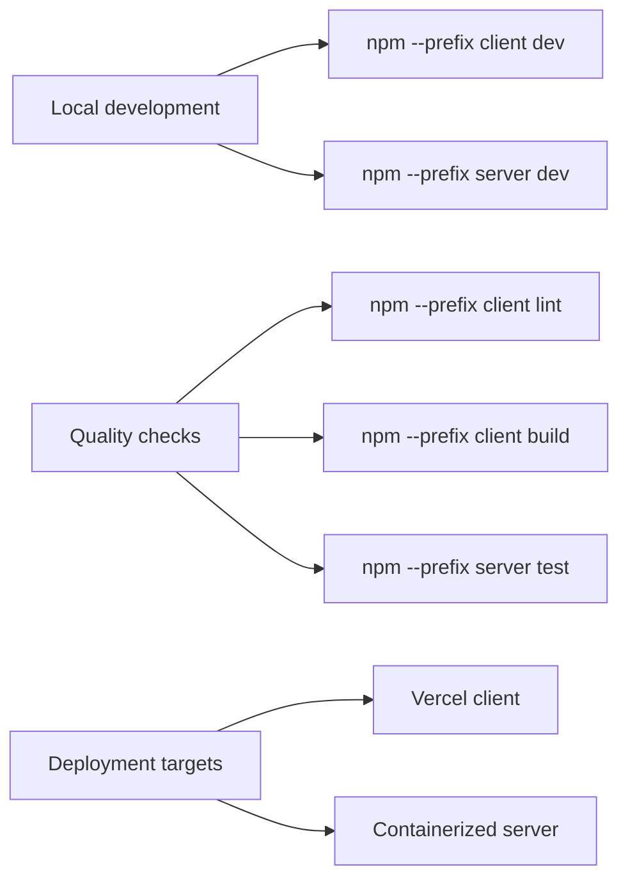
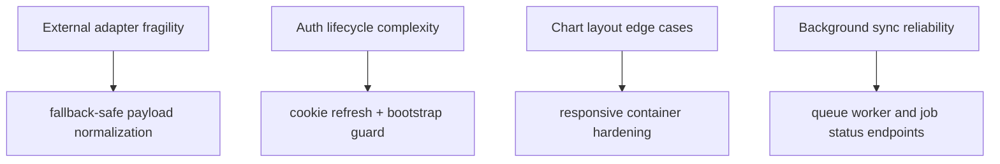

# Tech Stack (Diagram First)

This document models runtime and build stack layers used by DevFolio.

## Theoretical Foundation
Stack decisions follow architecture fitness and operational suitability principles.

- Technology choice is constrained by workload, team velocity, and operability.
- Layered tooling should optimize for reliability before novelty.
- Evolutionary architecture allows component replacement without systemic rewrites.

## 1. Layered Stack Diagram



## 2. Frontend Stack Map

```mermaid
flowchart LR
  R[React 19] --> ROUTER[react-router-dom]
  R --> QUERY[@tanstack/react-query]
  R --> STATE[zustand]
  R --> FORM[react-hook-form + zod]
  R --> UI[tailwindcss + radix slot + lucide icons]
  R --> CHARTS[recharts]
  R --> MOTION[framer-motion]
  R --> HTTP[axios]
  BUILD[Vite] --> R
  LINT[ESLint] --> R
```

## 3. Backend Stack Map



## 4. Data and Integration Layer



## 5. Build and Release Toolchain



## 6. Stack Risk and Hardening Focus



## 7. Practical Notes

- There is no root package script orchestrator; run client and server scripts from their own folders.
- Frontend API base URL is from VITE_API_URL or fallback /api.
- Backend env validation fails fast when required secrets are missing.