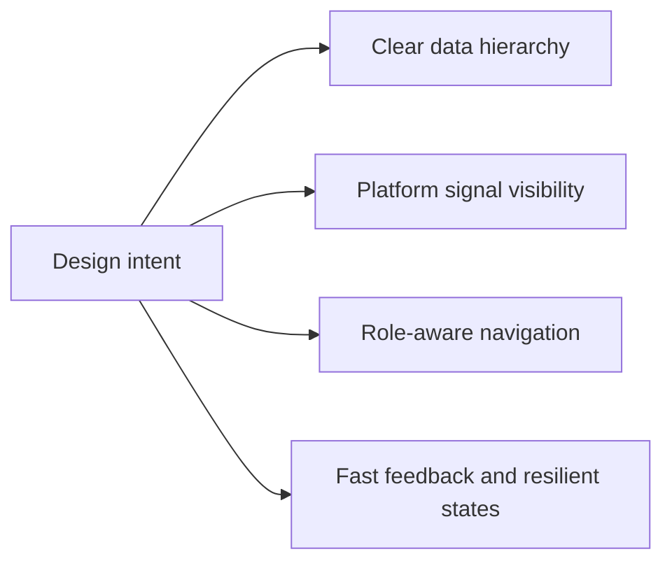
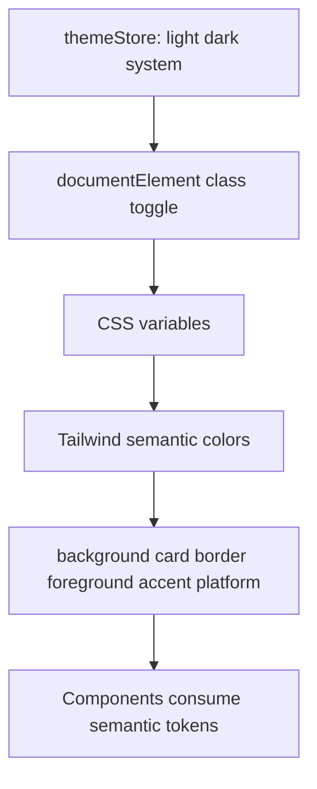
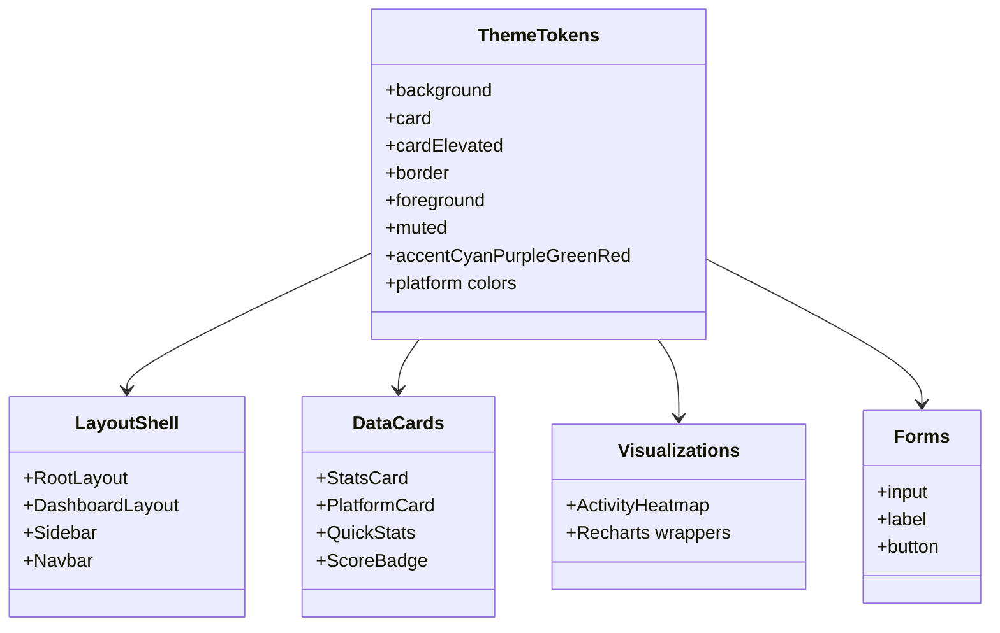
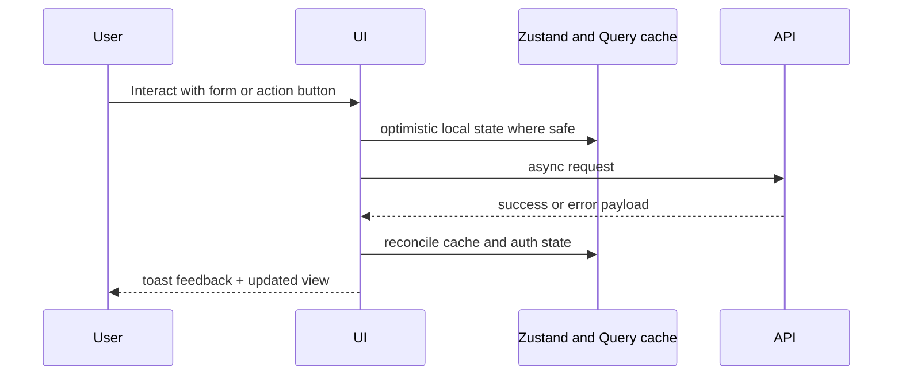
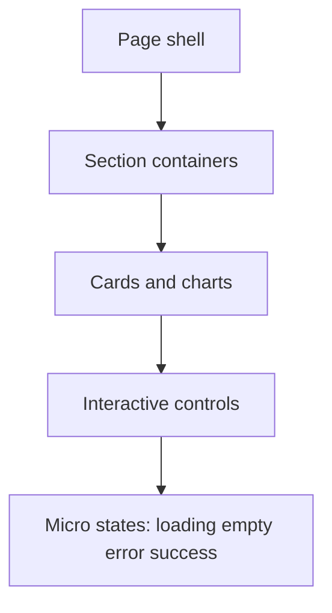
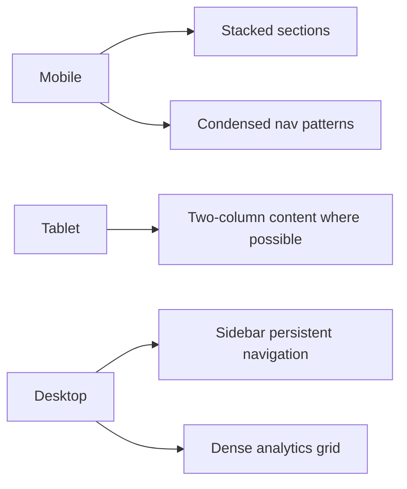
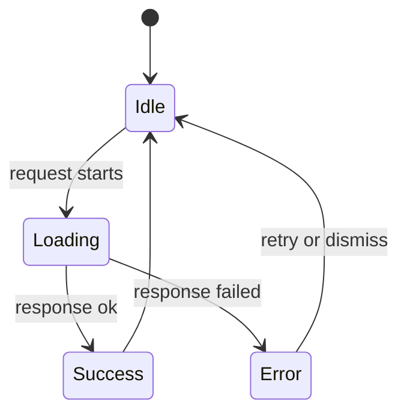

# UI and UX Design System (Diagram First)

This document describes visual tokens, component architecture, and UX interaction flows.

## Theoretical Foundation
UX system design applies cognitive-load management and consistency heuristics.

- Recognition-over-recall patterns reduce user effort on dense analytics surfaces.
- Semantic token systems preserve visual coherence across themes and states.
- Accessibility principles ensure inclusivity under different devices and abilities.

## 1. Design Intent Model

## 2. Theme and Token Architecture

## 3. Token-to-Component Mapping

## 4. Interaction Flow Standards

## 5. Surface Hierarchy

## 6. Responsive Behavior Model

## 7. Motion and Feedback Rules

## 8. Accessibility and Usability Checklist

- Keep semantic color tokens consistent across light and dark theme.
- Preserve readable contrast for card, text, and border surfaces.
- Provide keyboard reachable controls for all critical actions.
- Ensure chart containers render only when dimensions are valid.
- Render floating tooltips in portal layer to avoid clipping.