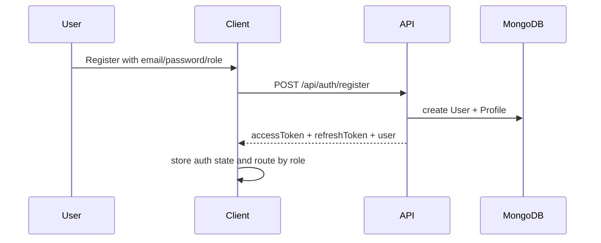
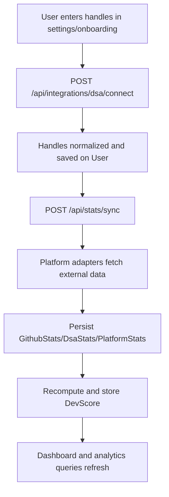
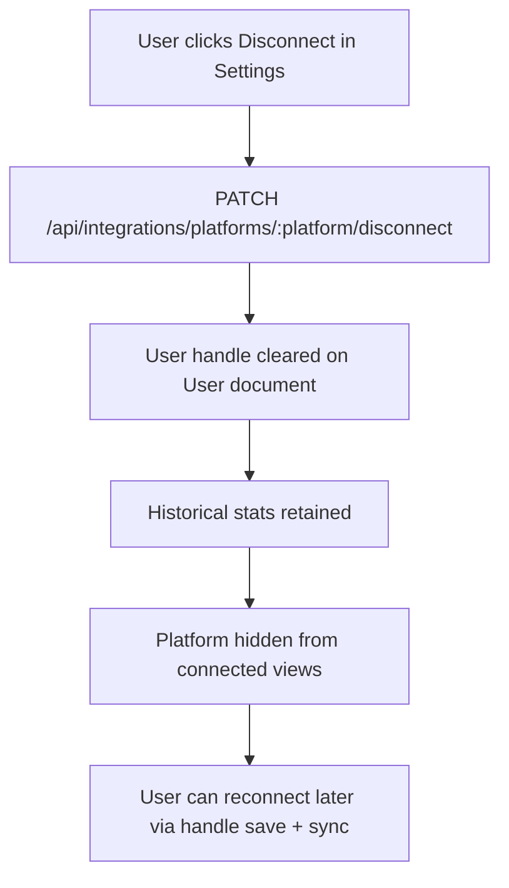
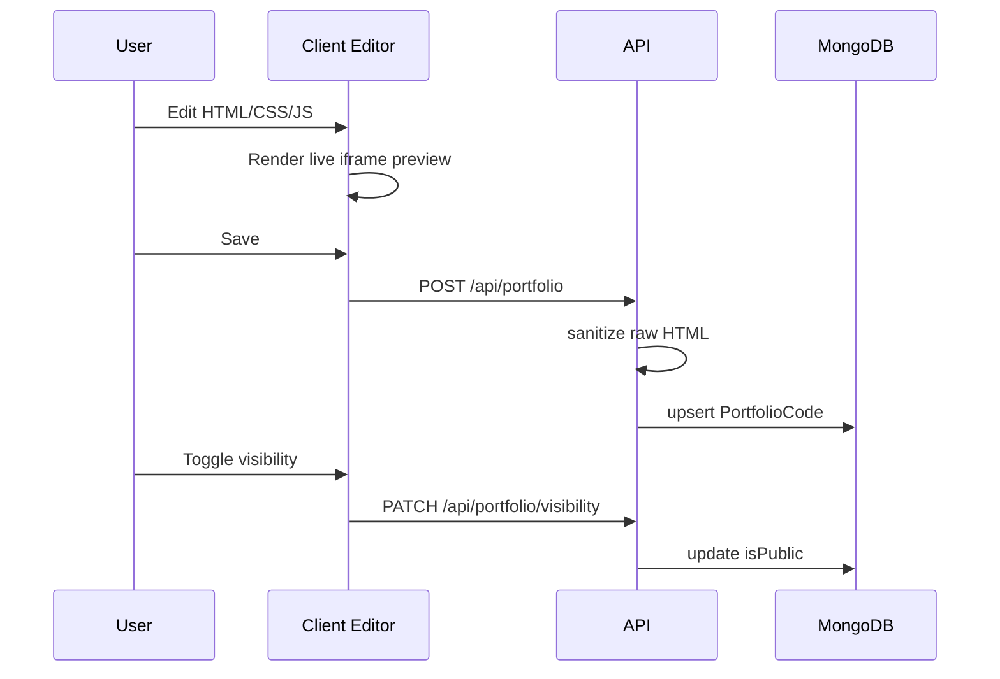

# Workflow

Last updated: 2026-03-29

## Workflow Index

- User onboarding and authentication
- Platform connection and sync
- DevScore lifecycle
- Portfolio lifecycle
- Recruiter discovery flow
- Admin operations flow
- Release validation workflow

## 1. User Onboarding and Authentication

Login path:

1. user submits credentials
2. API validates password hash
3. API issues access+refresh token pair
4. client stores tokens in auth store/localStorage strategy
5. protected routes call /api/user/me when needed

Refresh path:

1. request returns 401
2. axios interceptor requests /api/auth/refresh with stored refresh token
3. API verifies token and rotates
4. request retries with new access token

## 2. Platform Connection and Sync

Disconnect flow (soft delete):

Notes:

- disconnect is non-destructive for historical stats rows
- reconnect uses existing connect endpoint and new handle submission

## 3. DevScore Lifecycle

Primary computation triggers:

- manual: POST /api/score/recompute
- sync-linked: POST /api/stats/sync
- scheduled: nightly cron job

Lifecycle steps:

1. build platformData from stats collections
2. apply archetype and secondary archetype context
3. compute normalized platform signals
4. compute 5 pillar outputs
5. derive overall score + diagnostics
6. persist DevScore history (retention cap 30)

Consumption paths:

- dashboard score card and diagnostics
- leaderboard ranking modes
- compare view radar data
- public profile score section

## 4. Portfolio Lifecycle

Public preview lifecycle:

1. route resolves identifier as ObjectId or displayName
2. portfolio fetched by userId
3. visibility check enforced (owner can always view)
4. html/css/js assembled into sandboxed iframe

## 5. Recruiter Discovery Workflow

1. recruiter opens recruiter dashboard
2. enters filters (name, stack, college, score, archetype)
3. API route /api/recruiter/search applies profile and user filters
4. latest DevScore per candidate is attached
5. client renders candidate grid/list with score and portfolio availability

## 6. Admin Operations Workflow

1. admin loads /api/admin/stats and /api/admin/users
2. admin can:
   - change roles
   - delete users (cascade)
   - trigger global sync
3. global sync loops through connected users and updates stats/scores

## 7. Contest Feed Workflow

1. client requests /api/contests/upcoming
2. server cacheGet checks Redis cache
3. on miss, fetch Codeforces + LeetCode upcoming contests
4. merge and sort by start time
5. cache for 1 hour and return

## 8. Release Validation Workflow

Recommended pre-deploy flow:

1. frontend lint
2. frontend production build
3. backend tests
4. dependency audit
5. documentation sync
6. audit review and blocker closure

Detailed checklist: [devfolio_project_audit.md](./devfolio_project_audit.md) and [task.md](./task.md)

## Workflow Gaps to Track

- privacy checks should be consistently enforced across all optional-auth read endpoints
- token refresh architecture should migrate to httpOnly cookie flow
- scheduler execution should be made safe for multi-instance deployments
