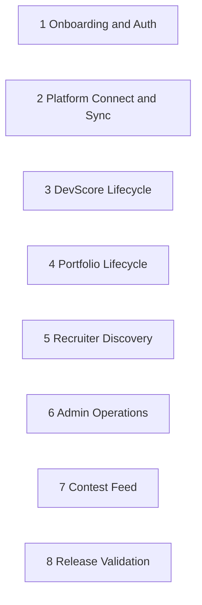
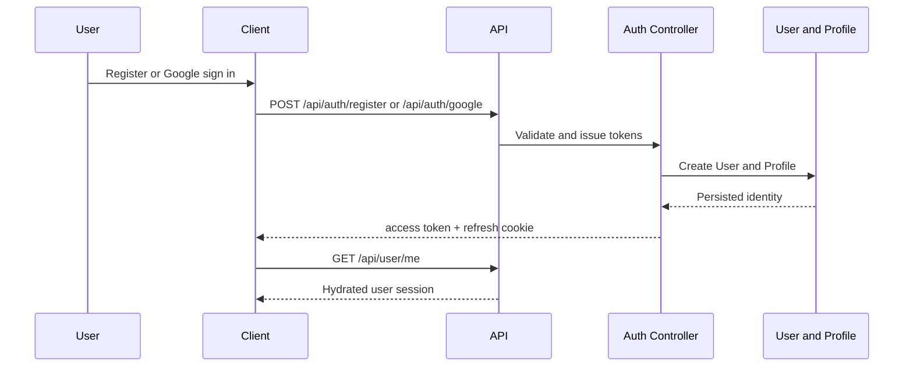
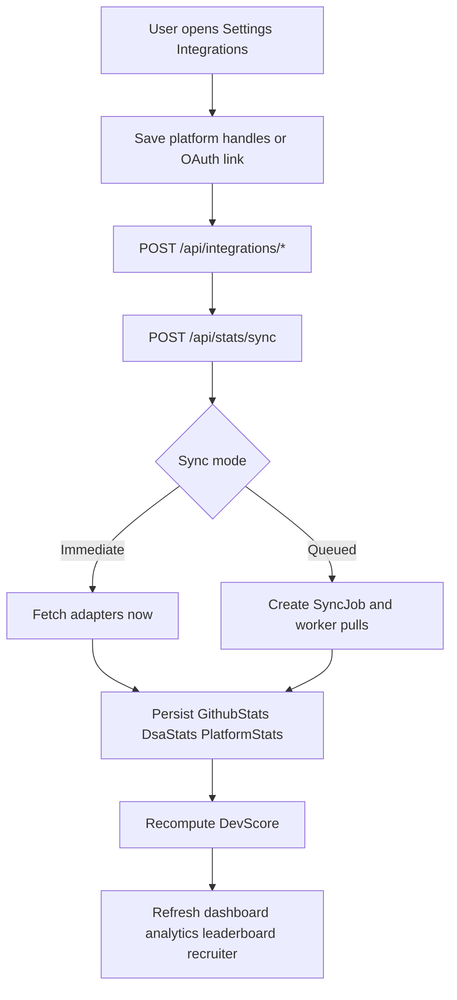
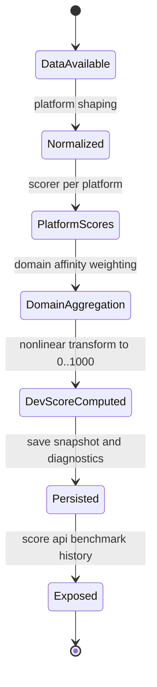
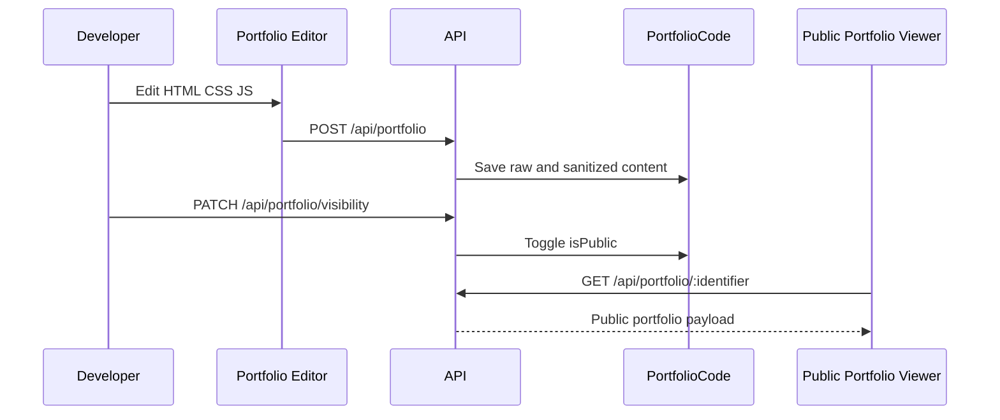
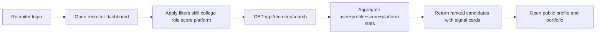
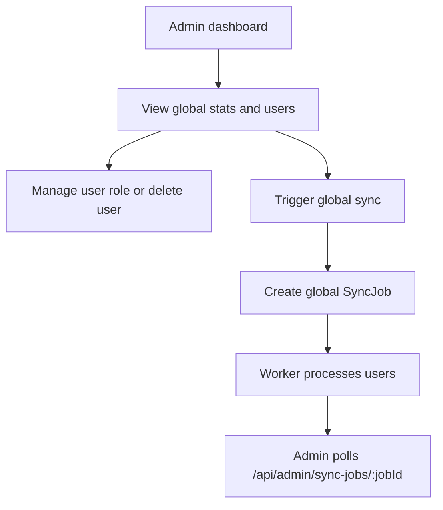
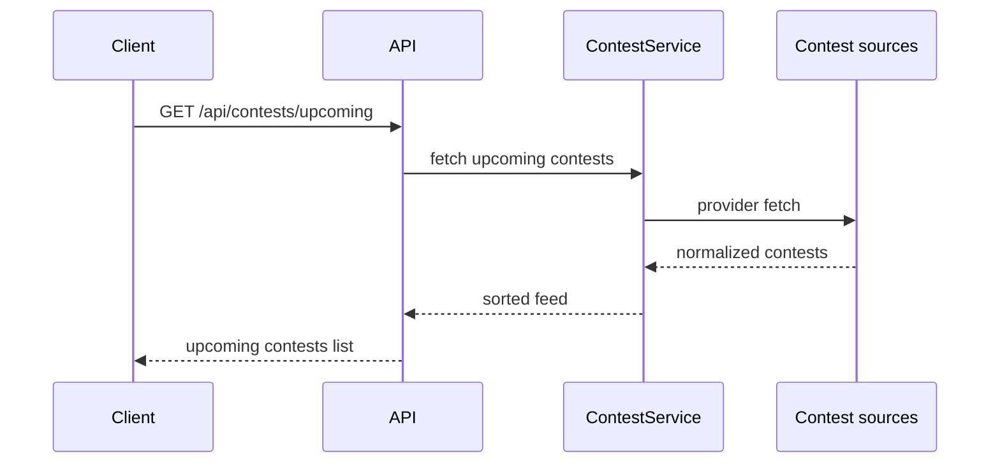
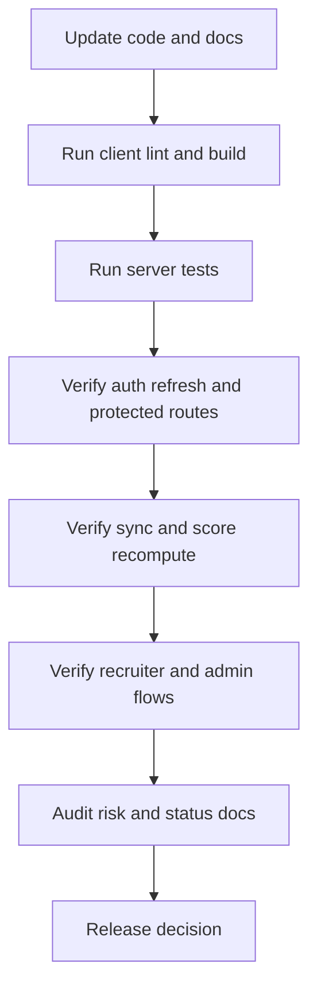

# Workflow (Diagram First)

This document captures all core user and system workflows as executable-style diagrams.

## Theoretical Foundation
Workflow modeling combines state-transition and process-orchestration concepts.

- Each workflow represents a finite sequence of guarded state changes.
- Async queue boundaries improve throughput while preserving control points.
- Feedback loops are necessary for adaptation, observability, and continuous improvement.

## Workflow Index

## 1. User Onboarding and Authentication

## 2. Platform Connection and Sync

## 3. DevScore Lifecycle

## 4. Portfolio Lifecycle

## 5. Recruiter Discovery Workflow

## 6. Admin Operations Workflow

## 7. Contest Feed Workflow

## 8. Release Validation Workflow

## Workflow Gaps To Track

- Expand e2e workflow automation for recruiter and admin paths.
- Keep queued sync observability and retry metrics visible.
- Keep docs and route contract changes synchronized.