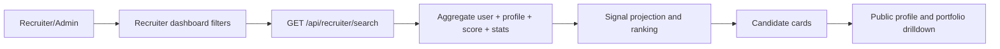
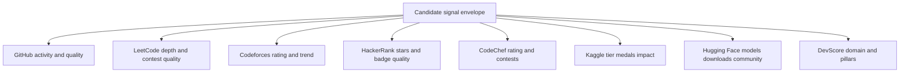
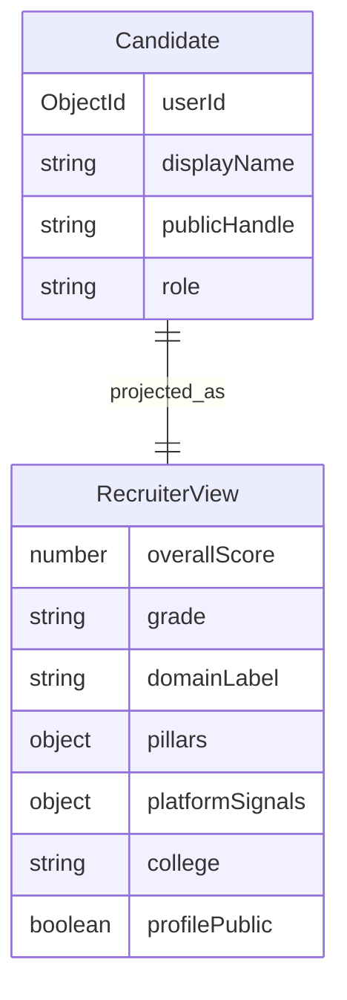
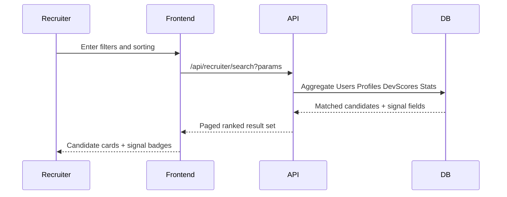
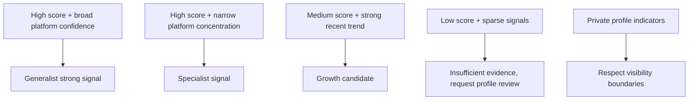

# Recruiter Platform Signals Catalog (Diagram First)

This document explains how recruiter search is powered by platform and score signals.

## Theoretical Foundation
Recruiter intelligence is based on evidence synthesis rather than single-metric ranking.

- Signal detection theory motivates combining multiple weak and strong indicators.
- Confidence-aware interpretation reduces false positives from sparse platform activity.
- Explainability is essential so ranking outcomes can be audited and trusted.

## 1. Recruiter Search Surface

## 2. Platform Signal Coverage

## 3. Candidate Projection ER View

## 4. Recruiter Query Workflow

## 5. Practical Interpretation Map

## 6. Search Input To Output Mapping

| Filter/Input | Data Source | Output Signal |
|---|---|---|
| Skill and keywords | Profile techStack, project metadata | Relevance match |
| College | Profile college | College-filtered ranking |
| Platform-specific interest | Stats collections | Platform badges and details |
| Performance threshold | DevScore score and pillars | Score-aware shortlist |
| Public visibility | Profile isPublic and owner rules | Access-controlled result set |

## 7. Limit and Boundary Notes

- Candidate output is visibility-aware and excludes private-only data for non-owners.
- Recruiter route is limited to recruiter and admin roles.
- Ranking should be interpreted with confidence and platform coverage, not score alone.