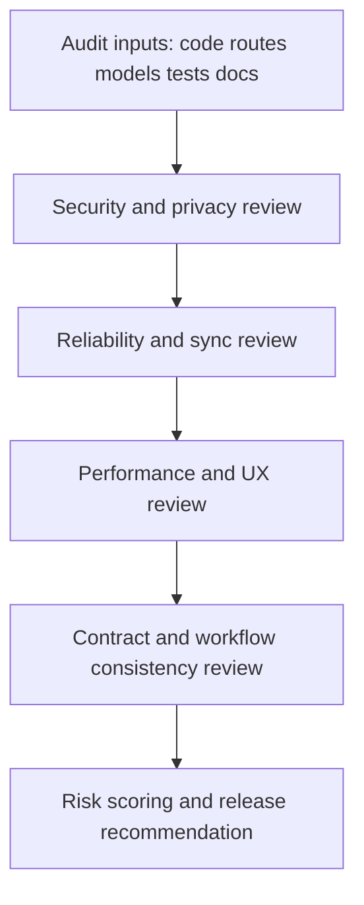
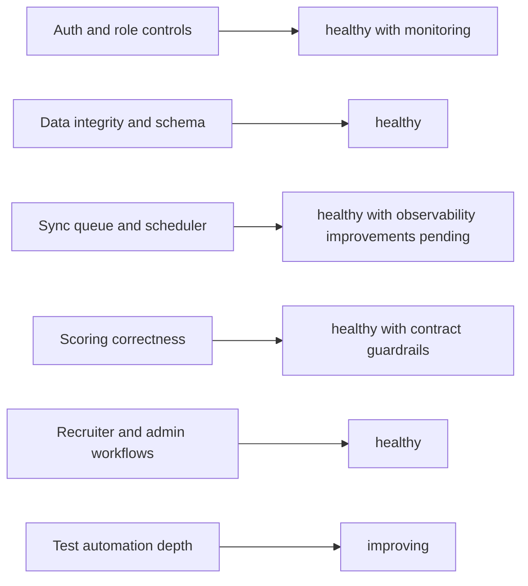
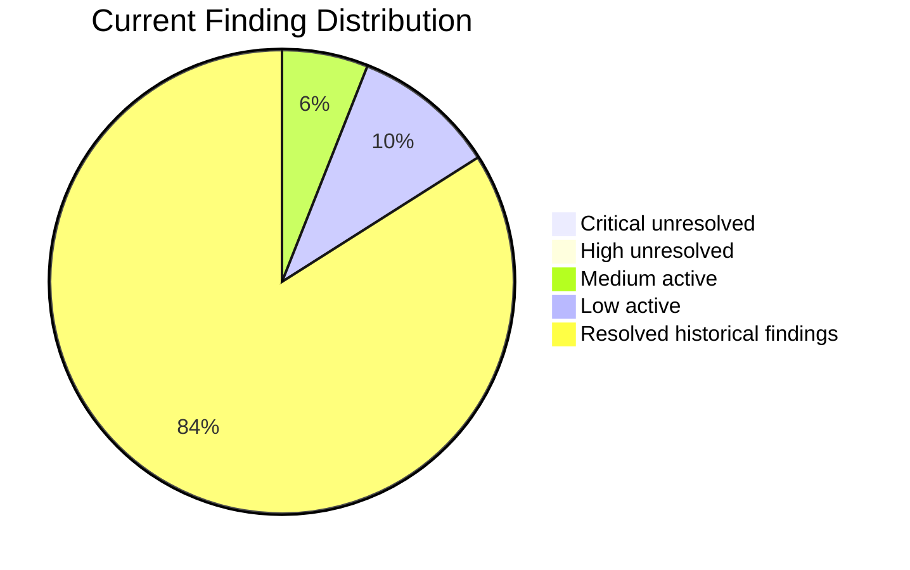
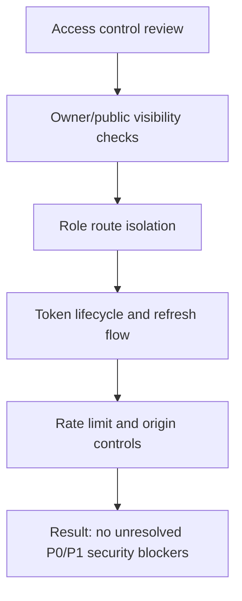
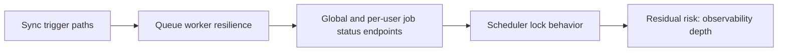
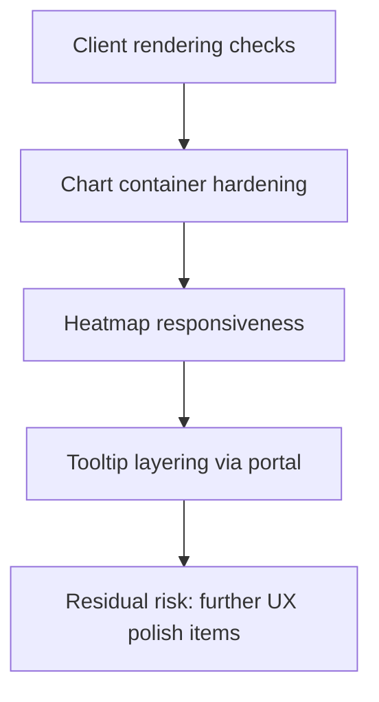
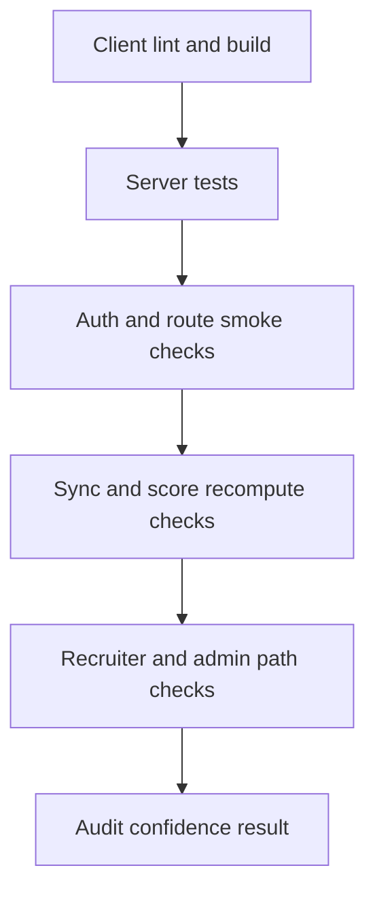
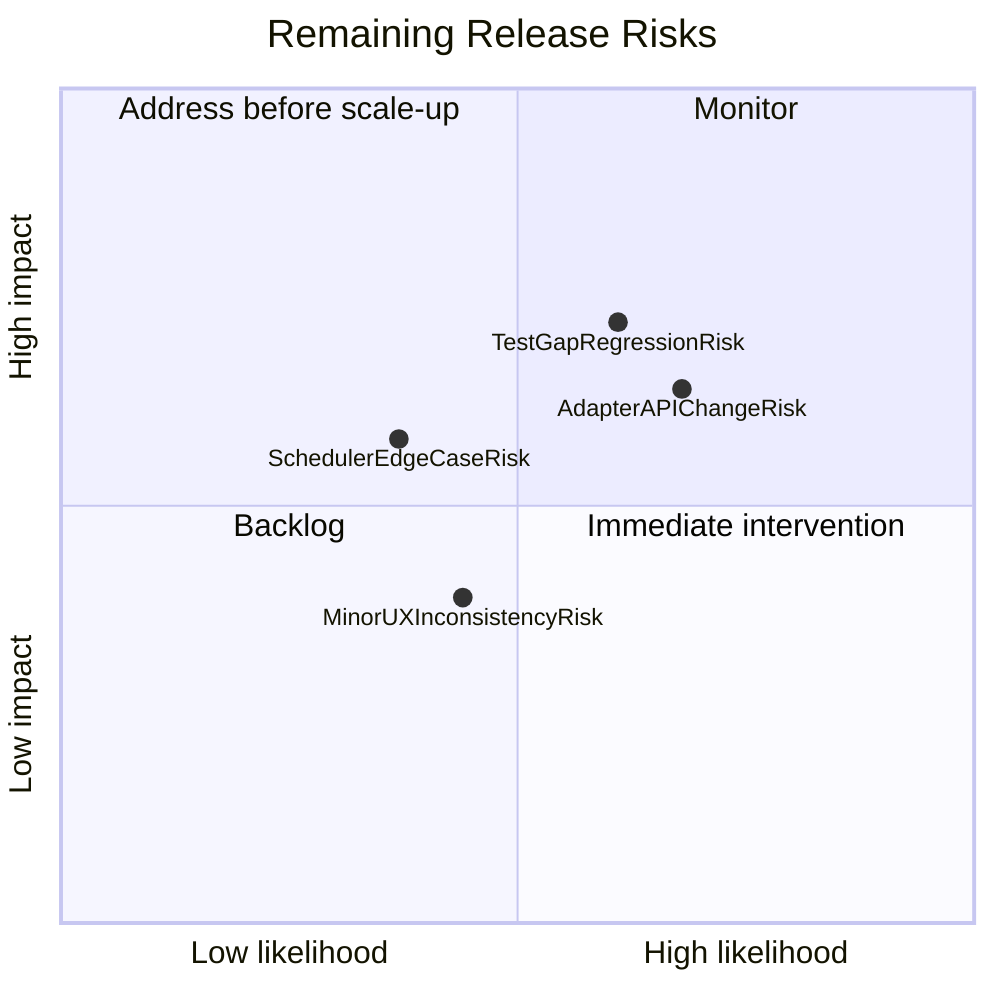
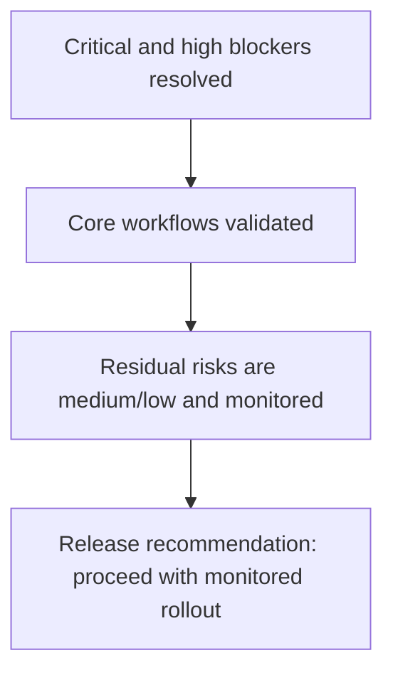
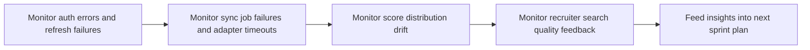

# DevFolio v1.0.1 Pre-Deployment Audit (Diagram First)

This audit summarizes release risk, subsystem health, and verification status.

## Theoretical Foundation
Audit methodology is evidence-driven and risk-oriented.

- Controls are assessed against concrete runtime evidence, not assumptions.
- Residual risk is tracked separately from resolved risk to preserve release clarity.
- Decision gates follow governance theory: verify, validate, then release.

## 1. Executive Audit Flow

## 2. Subsystem Health Dashboard

## 3. Findings Severity Distribution

## 4. Security Audit Model

## 5. Reliability and Operations Audit

## 6. Performance and UX Audit

## 7. Test and Verification Coverage

## 8. Risk Matrix

## 9. Release Decision Diagram

## 10. Post-Release Monitoring Plan

