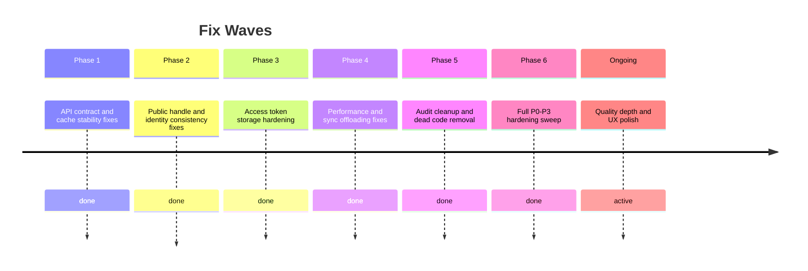
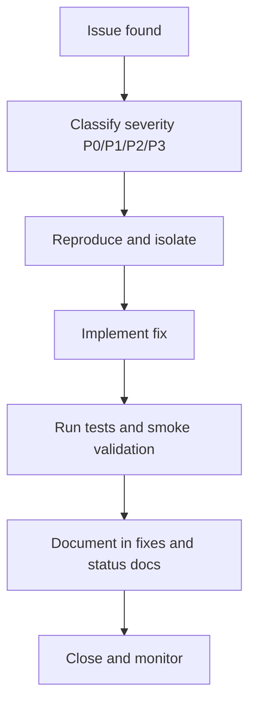
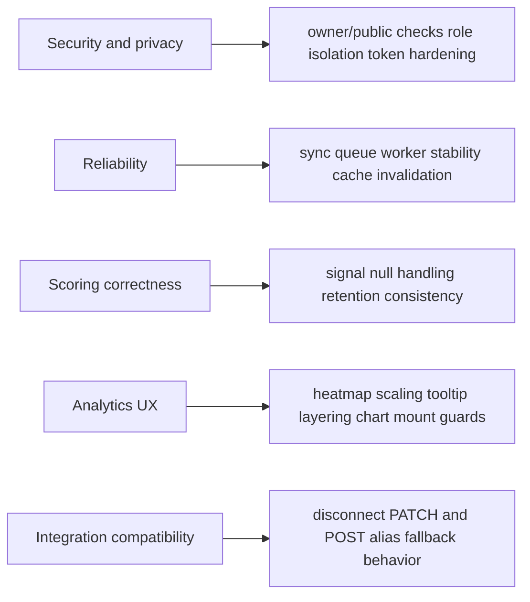
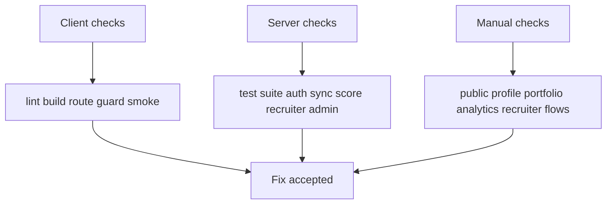
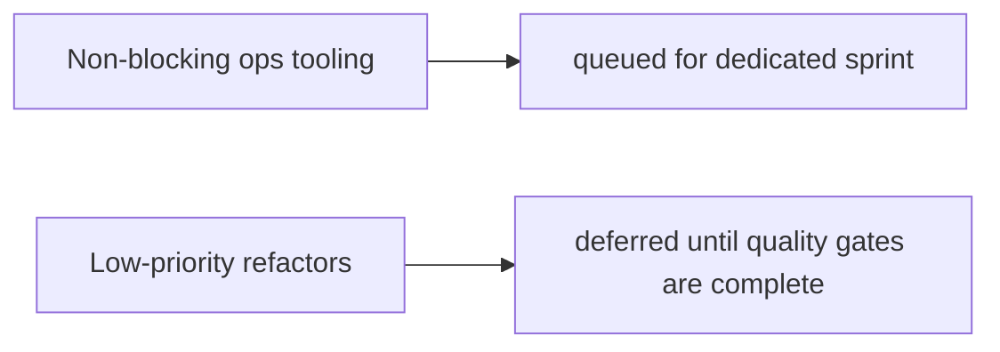

# Fixes Log (Diagram First)

This log visualizes major fix waves, issue lifecycle, and verification approach.

## Theoretical Foundation
Fix management follows a closed defect lifecycle from discovery to regression prevention.

- Severity classification aligns engineering effort with user and release risk.
- Root-cause analysis reduces repeated classes of defects.
- Validation evidence is required to convert a fix from implemented to trusted.

## 1. Fix Wave Timeline

## 2. Fix Lifecycle Diagram

## 3. Major Fix Domains

## 4. Verification Matrix

## 5. Open and Deferred Items

## 6. Fix Logging Rule

- Every fix entry should include problem summary, impacted files, validation performed, and regression risk.
- For cross-cutting fixes, update API, workflow, and status docs together.
- Keep severity labels aligned with deployment impact.