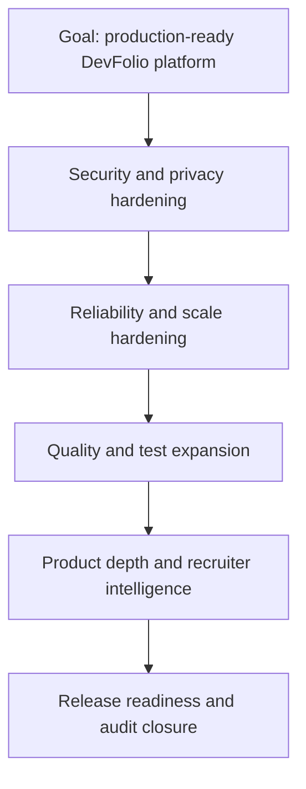
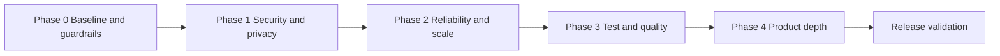
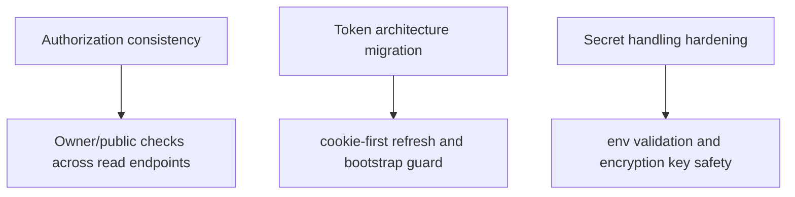
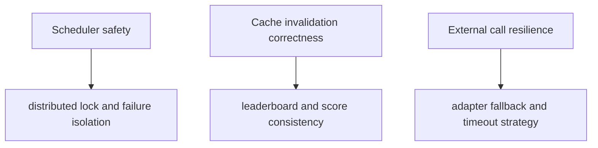
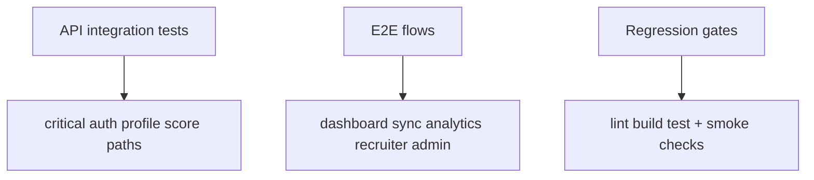
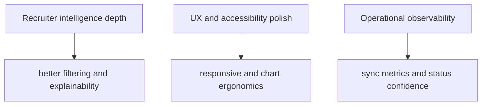
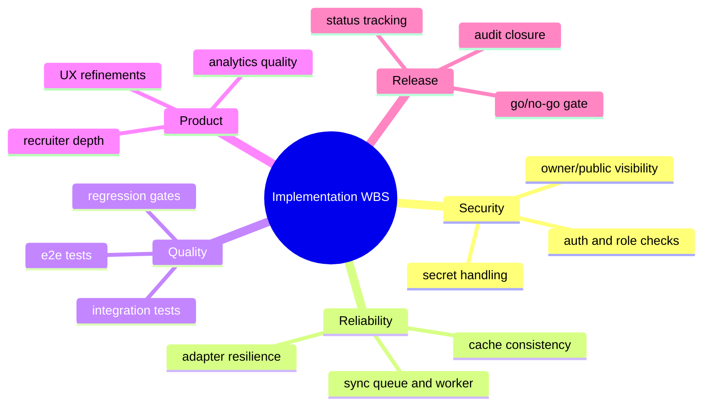
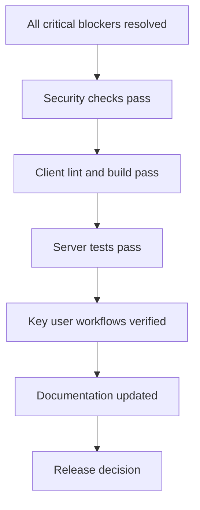

# Implementation Plan (Diagram First)

This plan organizes delivery into phases, workstreams, and release gates.

## Theoretical Foundation
Implementation planning uses incremental risk reduction and dependency-aware sequencing.

- Early phases target systemic risk before optimization and expansion.
- Phase gates prevent hidden instability from propagating downstream.
- Plan artifacts are executable governance tools, not static status documents.

## 1. Goal Flow

## 2. Phase Roadmap

## 3. Phase 1 Breakdown

## 4. Phase 2 Breakdown

## 5. Phase 3 Breakdown

## 6. Phase 4 Breakdown

## 7. Work Breakdown Structure

## 8. Exit Criteria Diagram

