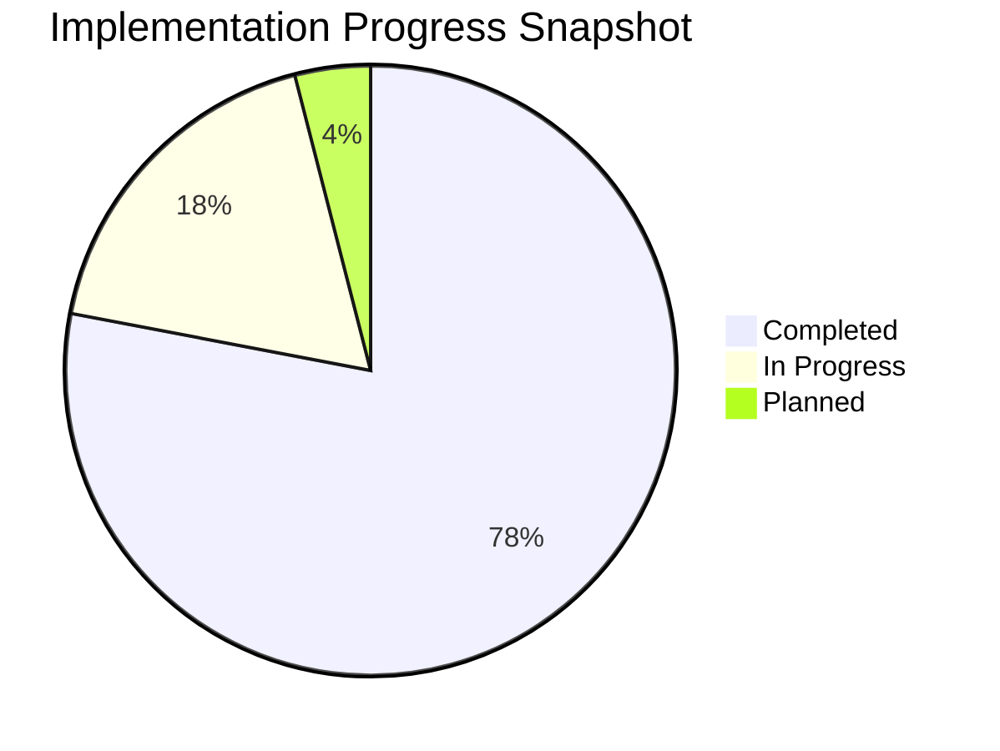
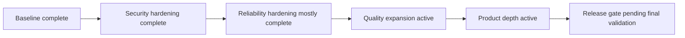
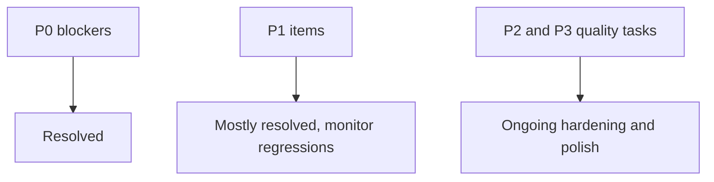
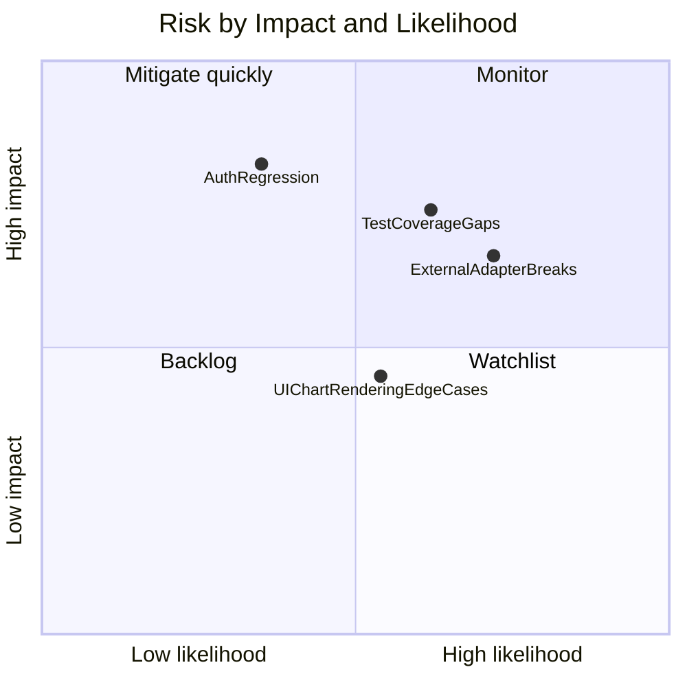
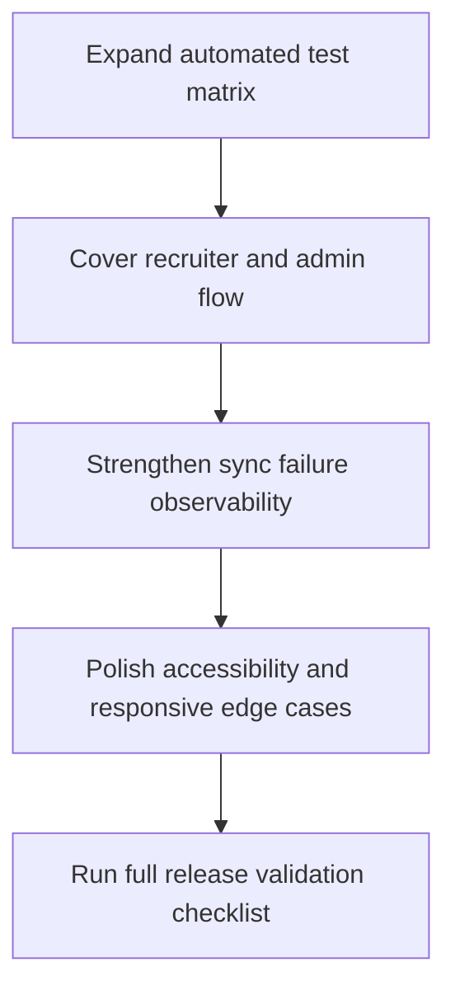

# Implementation Plan Status Tracker (Diagram First)

This tracker visualizes progress, open risk, and next actions.

## Theoretical Foundation
Status tracking combines leading and lagging indicators for realistic delivery confidence.

- Completion percentage alone is insufficient without risk and quality context.
- Confidence improves when validation depth grows alongside feature progress.
- Explicit risk visualization supports better release decisions.

## 1. Overall Progress Snapshot

## 2. Status Flow

## 3. Blocker Status Model

## 4. Current Risk Heatmap

## 5. Next Sprint Action Graph

## 6. Completion Criteria Tracker

| Gate | Current Status |
|---|---|
| Security posture | pass with continuous monitoring |
| Reliability and sync safety | pass with ongoing observability improvements |
| Quality automation | in progress |
| UX/accessibility polish | in progress |
| Documentation completeness | in progress with diagram-first rewrite |