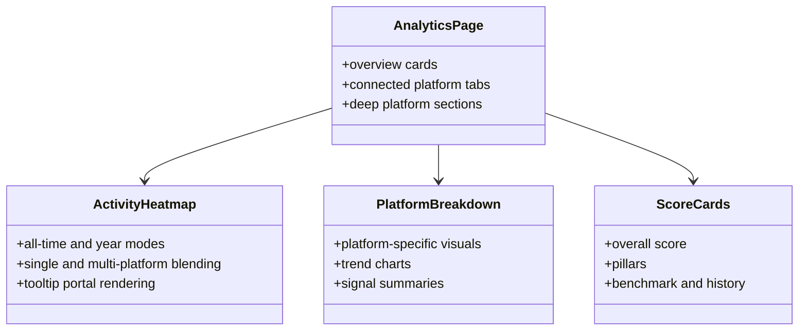
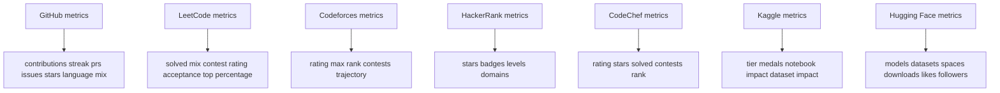
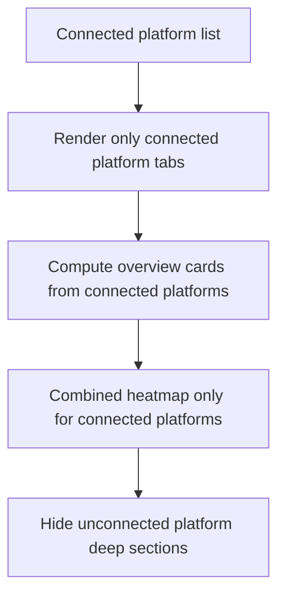
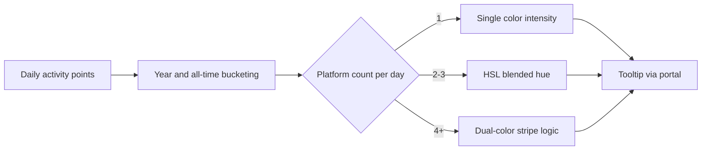
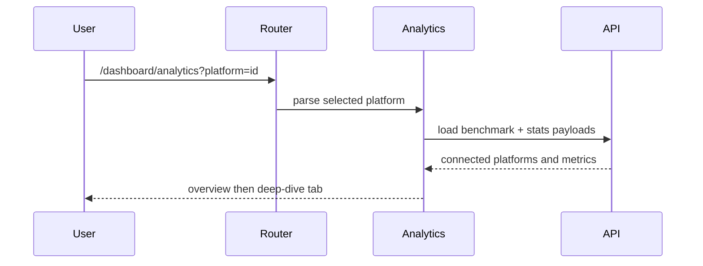

# Platform Analytics Catalog (Diagram First)

This catalog documents analytics components, platform metrics, and rendering behavior.

## Theoretical Foundation
Analytics design follows observability and metric-semantics principles.

- Metrics are valuable only when tied to clear interpretation models.
- Temporal aggregation must preserve trend meaning and comparability.
- Visualization should expose uncertainty and missing-data conditions explicitly.

## 1. Analytics Architecture

```mermaid
flowchart LR
  UI[Analytics page tabs and cards] --> API1[/api/score/:userId/benchmark]
  UI --> API2[/api/stats/github/:userId]
  UI --> API3[/api/stats/dsa/:userId]
  UI --> API4[/api/stats/platforms/:userId]
  UI --> API5[/api/score/:userId and history]

  API1 --> SCORE[(DevScore)]
  API2 --> GH[(GithubStats)]
  API3 --> DSA[(DsaStats)]
  API4 --> PLATFORM[(PlatformStats)]
  API5 --> SCORE
```

## 2. Shared Analytics Components



## 3. Metric Coverage By Platform



## 4. Connected Platform Scope Rules



## 5. Heatmap Rendering Model



## 6. Analytics Query and Tab Behavior



## 7. Diagnostic and Empty-State Rules

- If platform payload is missing, show empty state with connect guidance.
- If only one platform is connected, keep all overview cards scoped to that platform.
- Preserve zeros with nullish handling so valid zero metrics are not hidden.
- Use chart wrappers that wait for positive width and height before rendering.