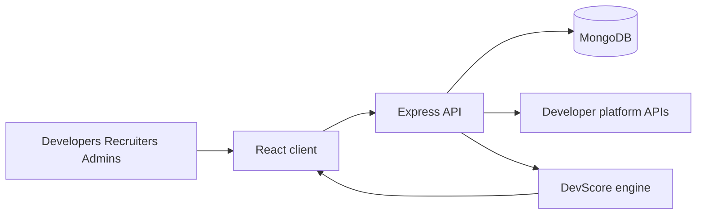
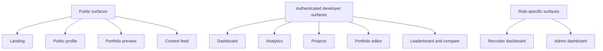
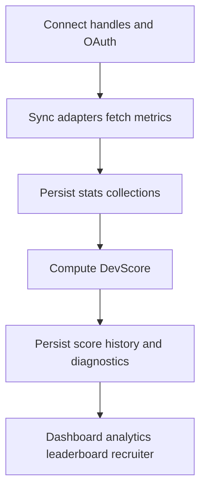
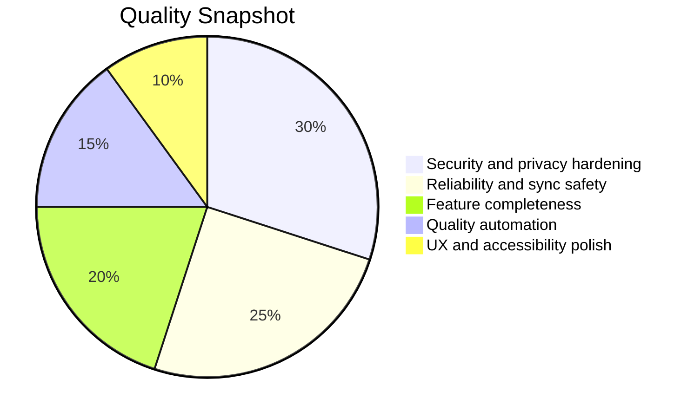
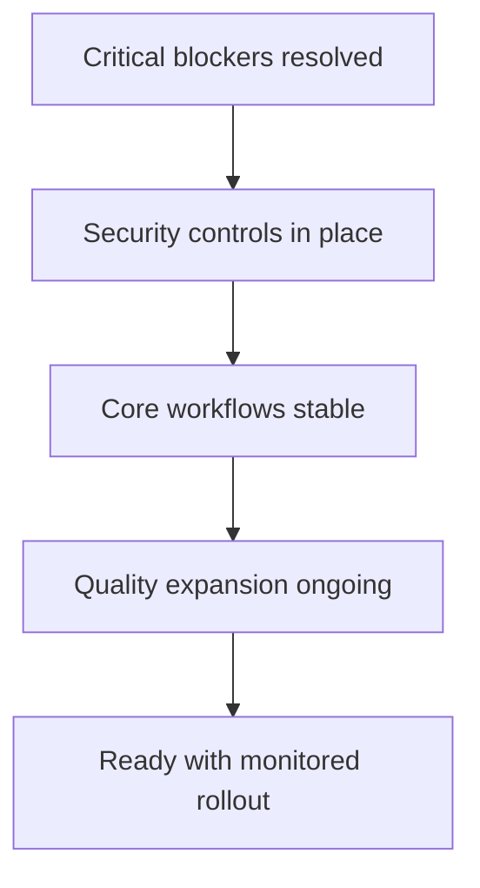
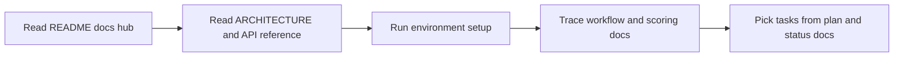

# DevFolio Summary (Diagram First)

This is the one-page visual summary of product, architecture, status, and release readiness.

## Theoretical Foundation
The summary uses systems thinking to unify product, engineering, and operations views.

- Platform value emerges from feedback loops between user behavior and analytics.
- Socio-technical alignment is required for trustworthy scoring and recruiter insight.
- Release readiness depends on both capability breadth and control maturity.

## 1. One-Page Project Picture

## 2. Product Surface Overview

## 3. Data and Scoring Lifecycle

## 4. Current Quality Snapshot

## 5. Readiness Assessment Model

## 6. Fast Onboarding Path

