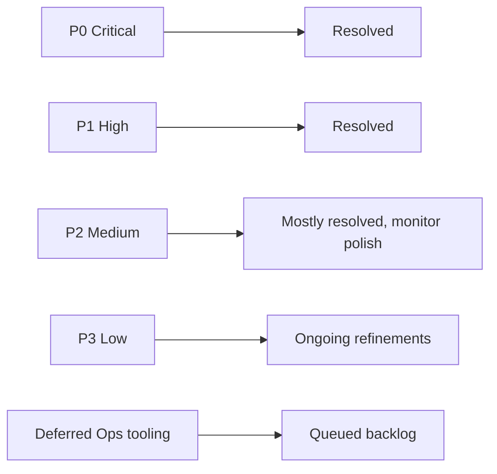
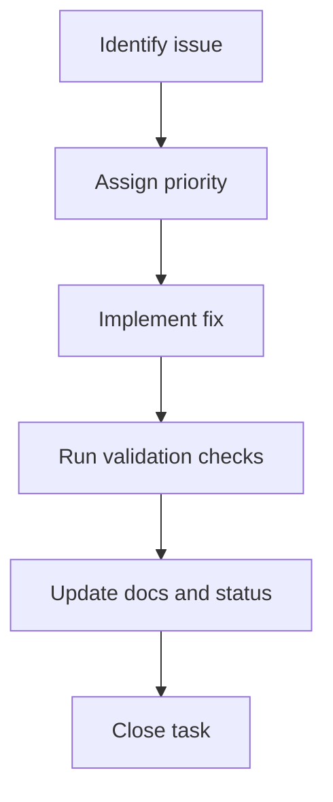
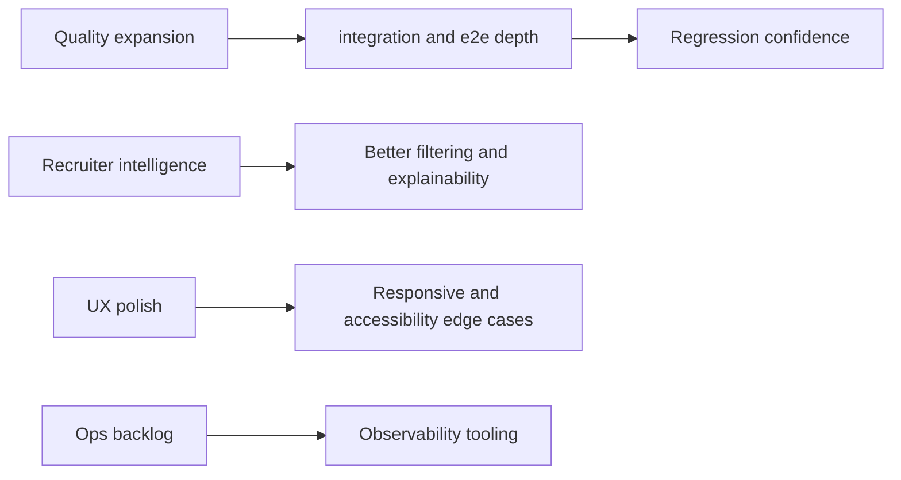
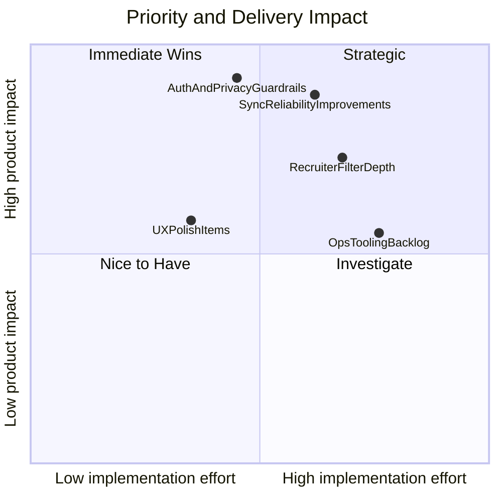

# DevFolio Prioritized Task Board (Diagram First)

This board visualizes current priority lanes and execution flow.

## Theoretical Foundation
Task prioritization is based on impact, urgency, and dependency constraints.

- High-risk blockers are resolved before optimization work.
- Work sequencing follows dependency topology to reduce rework.
- Closure criteria ensure tasks represent verified outcomes, not partial activity.

## 1. Task Board Overview

## 2. Execution Lane Diagram

## 3. Current Focus Pipeline

## 4. Priority-to-Impact Matrix

## 5. Board Status Table

| Lane | Status | Notes |
|---|---|---|
| P0 deployment blockers | resolved | security and privacy baseline completed |
| P1 launch blockers | resolved | reliability and core hardening completed |
| P2 quality and behavior | active | continued test and UX hardening |
| P3 polish | active | incremental refinements |
| Deferred ops tooling | queued | not release-blocking |

## 6. Task Closure Checklist

- Code change merged and tested.
- Related docs updated with diagrams and contract notes.
- Regression path validated across affected surfaces.
- Risk status updated in status and audit docs.